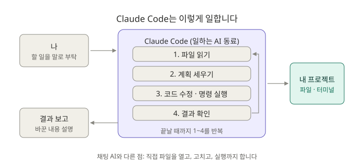
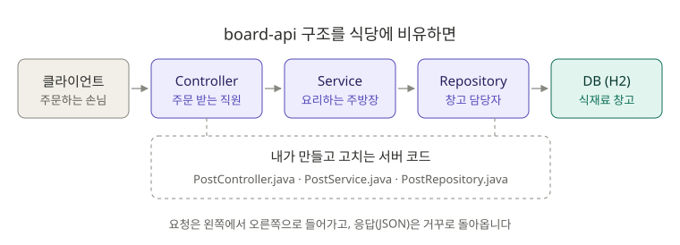

# 0장. 시작 전 준비: 설치하고 첫 대화 나누기

**⏱ 1시간** · **난이도 ⭐** · **실습 비중 60%**

## 🎯 이 장을 마치면

- Claude Code를 설치하고 `board-api` 프로젝트에서 대화를 시작할 수 있어요.
- Claude Code가 일반 채팅 AI와 **무엇이 다른지** 설명할 수 있어요.
- 처음 보는 프로젝트를 Claude와 함께 **10분 안에 파악**할 수 있어요.

---

## 🖼️ STEP 1. 그림으로 이해하기



**ChatGPT 같은 채팅 AI**는 내가 코드를 복사해서 붙여넣어야 하고, 답을 받으면 내가 다시 파일에 옮겨야 해요.

**Claude Code**는 **내 컴퓨터의 프로젝트 폴더 안에서 일하는 AI 동료**예요. 부탁을 받으면 직접 파일을 열어 읽고, 고치고, `./gradlew test` 같은 명령도 실행한 뒤 결과를 확인해요. 그래서 "이 에러 고쳐 줘"라고만 해도 관련 파일을 스스로 찾아갑니다.

> 🧩 **비유:** 채팅 AI가 "전화로 조언해 주는 선배"라면, Claude Code는 "내 자리에 와서 같이 키보드를 잡는 선배"예요. 대신 내 파일을 직접 고칠 수 있으니 **무엇을 고치는지 지켜보는 습관**이 중요해요.

---

## 📖 STEP 2. 핵심 개념

### ① 필요한 것

| 준비물 | 설명 |
|---|---|
| Claude 계정 | Pro, Max 같은 유료 구독 또는 API 키가 필요해요. 무료 플랜으로는 Claude Code를 쓸 수 없어요 |
| 터미널 | Windows는 **Windows Terminal**(PowerShell), macOS는 **터미널** 앱 |
| Git | 변경 이력 관리. Windows는 [Git for Windows](https://git-scm.com/downloads/win)를 설치하세요. **Git Bash** 터미널이 함께 설치돼요 |
| JDK 21 | `board-api` 실행용 |

> 🪟 **Windows 사용자는 이 가이드의 명령을 Git Bash에서 따라 하세요.** PowerShell은 `&&`, `mkdir -p`, `curl` 같은 명령이 다르게 동작해서 그대로 따라 하면 에러가 나요. 설치 명령(미션 0-1)만 PowerShell에서 실행합니다.

### ② 세 가지 화면 요소

| 요소 | 뜻 |
|---|---|
| `>` 입력창 | 여기에 부탁을 한국어로 쓰고 `Enter` |
| 권한 확인 창 | Claude가 파일을 고치거나 명령을 실행하기 전에 "해도 될까요?"라고 물어봐요. 내용을 읽고 허락하세요 |
| 진행 표시 | Claude가 어떤 파일을 읽고 있는지, 어떤 명령을 실행하는지 보여 줘요 |

> ⚠️ **권한 확인 창이 안 뜰 수도 있어요.** 최신 Claude Code는 따로 설정하지 않으면 **auto 모드**로 시작해요. auto 모드에서는 안전 검사기가 판단해서 묻지 않고 진행하는 경우가 많아요. 실습 프로젝트 `board-api`에는 **매번 물어보는 Manual 모드**로 시작하도록 `.claude/settings.json`을 미리 넣어 두었어요. 입력창 아래에 ⏸ 표시가 보이면 Manual 모드예요. 배우는 동안에는 Claude가 무엇을 바꾸는지 하나하나 보는 것이 좋아요. 모드는 8장에서 자세히 배워요.

### ③ 꼭 알아야 할 키 5개

| 키 | 하는 일 |
|---|---|
| `Enter` | 보내기 |
| `Esc` | Claude가 일하는 중에 **멈추기** (방향이 이상하면 바로 누르세요) |
| `Esc` 두 번 | 이전 시점으로 되돌리기 (8장에서 자세히) |
| `Shift + Tab` | 권한 모드 바꾸기 (Manual, 계획 모드 등. 8장에서 자세히) |
| `Ctrl + C` 두 번 또는 `/exit` | Claude Code 종료 |

### ④ 백엔드 기초: 요청 하나가 지나가는 길



`GET /api/posts/1` 요청이 오면 **Controller**가 받아서 **Service**에 넘기고, Service가 **Repository**를 통해 **DB**에서 1번 글을 꺼내 JSON으로 돌려줘요. 모르는 단어는 [용어집](../glossary.md)에서 찾아보세요.

### ⑤ 좋은 부탁의 4요소

Claude는 똑똑하지만 **내 머릿속은 모릅니다.** 신입 동료에게 일을 맡기듯 구체적으로 부탁하세요.

| 요소 | 나쁜 예 | 좋은 예 |
|---|---|---|
| **무엇을** | "고쳐 줘" | "게시글 상세 조회 API를 고쳐 줘" |
| **어디서** | (위치 없음) | "`@src/main/java/com/example/board/post/PostService.java`에서" |
| **왜/증상** | (증상 없음) | "없는 번호로 조회하면 500이 나는데, 404가 나와야 해" |
| **어떻게 확인** | (확인 방법 없음) | "고친 다음 `./gradlew test`로 확인해 줘" |

> 💡 **한 번에 하나씩.** "버그 고치고 테스트도 쓰고 문서도 만들어 줘"보다 하나 끝내고 다음을 부탁하는 편이 결과가 좋고, 검토하기도 쉬워요.

---

## 🛠️ STEP 3. 실습 미션

### 🟢 미션 0-1. Claude Code 설치하기 (10분)

**Windows** (PowerShell에서):

```powershell
irm https://claude.ai/install.ps1 | iex
```

**macOS / Linux** (터미널에서):

```bash
curl -fsSL https://claude.ai/install.sh | bash
```

설치가 끝나면 **터미널을 닫았다가 다시 열고** 확인합니다. Windows는 이제부터 **Git Bash**를 여세요.

```bash
claude --version
```

✅ **성공 기준:** 버전 번호(예: `2.1.302`)가 나와요.

<details>
<summary>❌ <code>claude</code>를 찾을 수 없다고 나와요</summary>

- 터미널을 완전히 닫고 새로 열어 보세요. 설치 경로가 새 창에서야 적용돼요.
- 그래도 안 되면 설치 마지막에 출력된 안내(PATH 추가 방법)를 다시 확인하세요.
- 다른 설치 방법: Windows는 `winget install Anthropic.ClaudeCode`, macOS는 `brew install --cask claude-code`

</details>

### 🟢 미션 0-2. 실습 프로젝트 준비하기 (10분)

이 저장소를 클론한 폴더에서 실행하세요.

```bash
cp -r ko/practice/board-api ~/board-api
cd ~/board-api
git init && git add . && git commit -m "init: board-api 실습 시작"
./gradlew bootRun
```

로그 마지막에 `Started BoardApplication`이 보이면 서버가 켜진 거예요. 새 터미널 창을 열어 API를 호출해 봅니다.

```bash
curl http://localhost:8080/api/posts
```

✅ **성공 기준:** 게시글 3개가 JSON으로 나와요. 확인했으면 서버 창에서 `Ctrl + C`로 서버를 끄세요.

> 💡 **왜 저장소 밖으로 복사하나요?** Claude Code는 실행한 폴더와 그 위쪽 폴더의 `CLAUDE.md`를 자동으로 읽어요. 이 저장소에는 튜토리얼 작성용 `CLAUDE.md`가 있어서, 안에서 실습하면 Claude가 엉뚱한 규칙을 따를 수 있어요.

### 🟢 미션 0-3. Claude Code 켜고 로그인하기 (5분)

```bash
cd ~/board-api
claude
```

처음 실행하면 브라우저가 열리고 로그인을 요청해요. 로그인 후 "이 폴더를 신뢰하나요?"라고 물으면 내 프로젝트이므로 허락합니다.

✅ **성공 기준:** `>` 입력창이 보이고, 그 아래에 ⏸(Manual 모드) 표시가 있어요. 다른 모드가 보이면 `Shift + Tab`을 눌러 Manual로 바꾸세요.

### 🔵 미션 0-4. 처음 받은 프로젝트 파악하기 (10분)

신입으로 입사해서 처음 코드를 받았다고 생각하고, 아래 부탁을 **하나씩** 보내 보세요.

```text
이 프로젝트가 어떤 프로젝트인지 신입 백엔드 개발자에게 설명하듯 알려줘.
사용한 기술, 폴더 구조, 주요 기능을 표로 정리해 줘.
```

```text
GET /api/posts/1 요청이 들어오면 어떤 파일의 어떤 메서드를 거쳐서 응답이 나가는지 순서대로 알려줘.
```

```text
@src/main/java/com/example/board/post/PostService.java 이 파일에서 신입이 꼭 이해해야 할 부분 3가지만 알려줘.
```

> 💡 `@`로 시작하는 파일 경로를 쓰면 Claude가 그 파일을 바로 읽어요. `@src/`까지 입력하면 자동 완성도 돼요.

✅ **성공 기준:** Controller → Service → Repository 순서를 내 말로 설명할 수 있어요.

### 🔵 미션 0-5. 권한 확인 창 경험하기 (5분)

```text
방금 설명한 내용을 docs/project-overview.md 파일로 저장해 줘.
```

Claude가 파일을 만들기 전에 **권한 확인 창**을 띄워요. 어떤 파일을 어떻게 만드는지 읽어 보고 허락하세요.

✅ **성공 기준:** `docs/project-overview.md` 파일이 생겼어요. 📁 **포트폴리오 결과물 1호**입니다.

### 🔴 도전 0-6. 서버 실행까지 맡겨 보기 (10분)

```text
테스트를 실행해서 통과하는지 확인해 줘.
```

Claude가 `./gradlew test`를 실행하겠다고 물어보면 허락하세요. 결과를 보고 나서 **Claude가 어떤 명령을 실행했는지** 내 말로 다시 설명해 보세요.

마무리로 지금까지의 작업을 커밋해 둡니다.

```bash
git add . && git commit -m "docs: 프로젝트 구조 정리"
```

---

## ❓ STEP 4. 바로 퀴즈

**Q1.** Claude Code가 채팅 AI와 가장 크게 다른 점은?

1. 한국어를 더 잘한다
2. 내 프로젝트의 파일을 직접 읽고 고치고 명령을 실행한다
3. 인터넷 없이 동작한다
4. 무료다

<details>
<summary>정답 보기</summary>

**2번.** 복사·붙여넣기 없이 프로젝트 안에서 직접 일하는 것이 핵심이에요.

</details>

**Q2.** Claude가 이상한 방향으로 코드를 고치기 시작했어요. 바로 눌러야 할 키는?

<details>
<summary>정답 보기</summary>

**`Esc`.** 진행 중인 작업을 멈추고 다시 지시할 수 있어요.

</details>

**Q3.** 대화 중에 `@src/main/java/com/example/board/post/PostController.java`라고 쓰면 무슨 일이 일어나나요?

<details>
<summary>정답 보기</summary>

Claude가 **그 파일을 바로 읽어서** 대화에 포함해요. 어떤 파일을 봐야 하는지 정확히 알려 줄 때 써요.

</details>

**Q4.** 게시글 1번이 없는데 `GET /api/posts/1`을 호출했을 때, 올바른 HTTP 상태 코드는? (힌트: 용어집)

<details>
<summary>정답 보기</summary>

**404 Not Found.** 그런데 지금 `board-api`는 500을 돌려줘요. 이게 1장에서 고칠 첫 번째 버그입니다.

</details>

**Q5.** 실습 프로젝트를 이 저장소 밖(`~/board-api`)으로 복사하는 이유는?

<details>
<summary>정답 보기</summary>

Claude Code는 상위 폴더의 `CLAUDE.md`까지 읽어요. 저장소의 튜토리얼 작성 규칙이 실습에 섞이지 않게 하려는 거예요.

</details>

---

## 🏢 STEP 5. 현장 레시피: 첫 출근 날 쓰는 부탁 3가지

```text
이 프로젝트를 로컬에서 실행하는 방법을 순서대로 알려줘. 필요한 설정 파일과 환경 변수도 알려줘.
```

```text
이 프로젝트의 API 목록을 표로 정리해 줘. 메서드, URL, 하는 일, 담당 Controller를 포함해 줘.
```

```text
신입이 이 코드에서 처음 맡기 좋은 쉬운 작업 3가지를 추천해 줘. 이유도 같이.
```

> ⚠️ 회사 코드에서 쓸 때는 **회사의 AI 도구 사용 규칙**부터 확인하세요. 비밀번호, 키 같은 민감한 정보는 Claude에게 붙여넣지 마세요.

---

## 🎤 STEP 6. 면접 한마디

> "처음 보는 프로젝트는 Claude Code에게 요청 흐름을 추적하게 해서 Controller부터 Repository까지 구조를 빠르게 파악했고, 파악한 내용은 문서로 남겨 팀원과 공유했습니다."

---

## ✅ 마무리 체크

- [ ] `claude --version`이 나온다
- [ ] `board-api`를 실행하고 `curl`로 응답을 받았다
- [ ] Claude에게 프로젝트 구조를 물어보고 요청 흐름을 내 말로 설명할 수 있다
- [ ] `docs/project-overview.md`를 만들고 커밋했다
- [ ] 퀴즈 5문제를 모두 맞혔다

**다음 장 → [1장. 슬래시 명령](../01-slash-commands/README.md)**

## 📚 더 알아보기

- 설치 방법과 CLI 옵션 전체: [원문 10장 CLI](../../10-cli/README.md)
- 공식 문서: [Claude Code 시작하기](https://code.claude.com/docs/en/quickstart)
