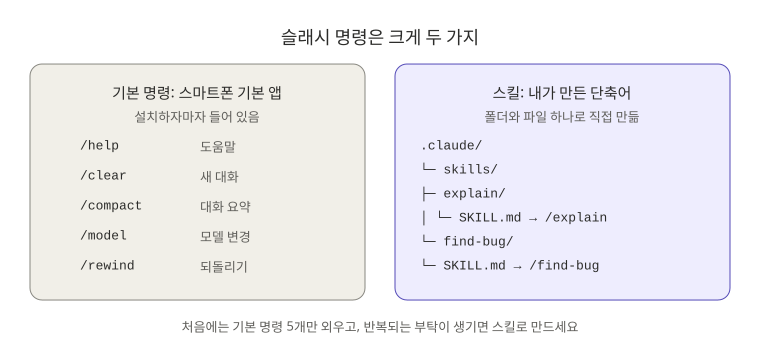
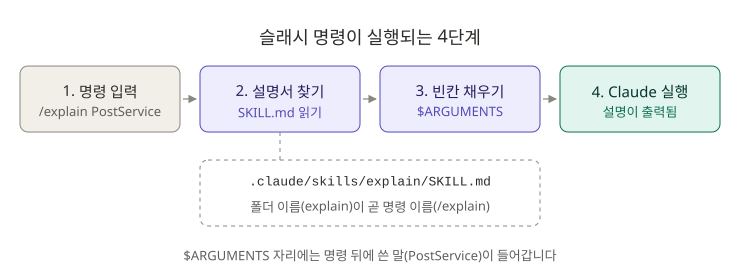
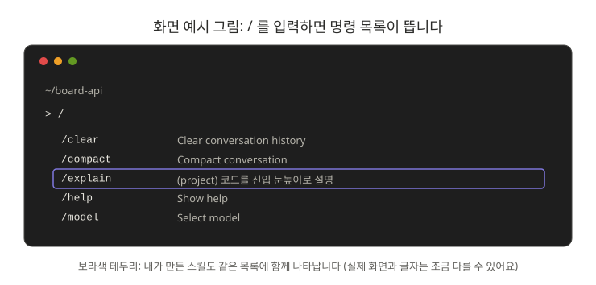

# 1장. 슬래시 명령: 자주 하는 부탁을 단축키로

**⏱ 1시간** · **난이도 ⭐** · **실습 비중 60%**

## 🎯 이 장을 마치면

- 기본 명령 5개로 대화를 정리하고, 새로 시작하고, 모델을 바꿀 수 있어요.
- `SKILL.md` 파일 하나로 **나만의 명령**을 만들 수 있어요.
- 직접 만든 `/find-bug`로 `board-api`의 **첫 번째 버그(500 에러)** 를 고쳐요.

---

## 🖼️ STEP 1. 그림으로 이해하기



> 🧩 **비유:** 스마트폰에는 처음부터 깔려 있는 **기본 앱**이 있고, 내가 자주 하는 동작을 묶은 **단축어**를 직접 만들 수도 있죠. Claude Code도 똑같아요. `/help`, `/clear` 같은 **기본 명령**이 있고, 자주 하는 부탁은 **스킬**로 만들어 `/이름` 한 줄로 실행해요.



`/explain PostService`를 입력하면 Claude Code는 `.claude/skills/explain/SKILL.md`를 찾아 읽고, 파일 속 `$ARGUMENTS` 자리에 `PostService`를 넣은 뒤 그 내용대로 일해요. **SKILL.md는 Claude에게 주는 작업 지시서**라고 생각하면 됩니다.



---

## 📖 STEP 2. 핵심 개념

### ① 처음 외울 기본 명령 5개

전체 명령은 60개가 넘지만, `/`만 입력하면 목록이 뜨니까 외울 필요는 없어요. 이 다섯 개만 먼저 손에 익히세요.

| 명령 | 하는 일 | 이럴 때 쓰세요 |
|---|---|---|
| `/help` | 도움말 보기 | 뭘 해야 할지 모를 때 |
| `/clear` | 대화를 지우고 새로 시작 | **다른 작업으로 넘어갈 때.** 이전 대화가 섞이지 않아요 |
| `/compact` | 지금까지 대화를 요약해서 공간 확보 | 같은 작업을 계속하는데 대화가 너무 길어졌을 때 |
| `/model` | AI 모델 바꾸기 | 더 빠른 답이나 더 깊은 분석이 필요할 때 |
| `/rewind` | 이전 시점으로 되돌리기 | 결과가 마음에 안 들 때 (8장에서 자세히) |

> 💡 **`/clear`와 `/compact`의 차이:** `/clear`는 "새 노트 펴기", `/compact`는 "지금까지 쓴 노트를 한 장으로 요약하기"예요.

### ② 스킬 = 폴더 하나 + SKILL.md 하나

```text
board-api/
└── .claude/
    └── skills/
        └── find-bug/          ← 폴더 이름이 곧 명령 이름 (/find-bug)
            └── SKILL.md       ← 파일 이름은 반드시 대문자 SKILL.md
```

`.claude/skills/`는 **이 프로젝트에서만** 쓰는 명령이에요. 모든 프로젝트에서 쓰고 싶으면 홈 폴더의 `~/.claude/skills/`에 넣으세요.

### ③ SKILL.md의 생김새

```yaml
---
name: explain
description: 코드나 개념을 신입 눈높이로 설명한다. 코드를 이해하지 못했을 때 사용한다.
---

설명할 대상: $ARGUMENTS
(여기부터는 Claude에게 주는 작업 지시)
```

| 부분 | 뜻 |
|---|---|
| `---` 사이 (프런트매터) | 명령의 설정. `name`은 명령 이름, `description`은 "언제 쓰는 명령인지" 설명 |
| `---` 아래 (본문) | Claude가 따라 할 작업 지시 |
| `$ARGUMENTS` | 명령 뒤에 쓴 말이 들어가는 빈칸. `/explain PostService` → `PostService` |

> 📝 예전에는 `.claude/commands/이름.md` 파일로 명령을 만들었어요. 지금도 동작하지만 새로 만들 때는 `skills`를 쓰세요.

---

## 🛠️ STEP 3. 실습 미션

모든 미션은 `~/board-api`에서 `claude`를 실행한 상태에서 진행해요. (0장 미션 0-2 참고)

### 🟢 미션 1-1. 기본 명령 써 보기 (5분)

1. 입력창에 `/`만 입력하고 목록을 훑어보세요. 위아래 화살표로 움직이고 `Esc`로 닫아요.
2. `/help`를 실행해 보세요.
3. Claude에게 아무 질문이나 한 뒤 `/clear`를 실행하고, "방금 내가 뭐 물어봤지?"라고 물어보세요.

✅ **성공 기준:** `/clear` 뒤에는 Claude가 이전 대화를 기억하지 못해요.

### 🟢 미션 1-2. 첫 스킬 `/explain` 직접 만들기 (15분)

복사하지 말고 **직접 만들어 보는 것**이 목표예요. 새 터미널 창에서 폴더를 만듭니다.

```bash
cd ~/board-api
mkdir -p .claude/skills/explain
```

> 💡 명령어가 어렵다면 Claude에게 "`.claude/skills/explain` 폴더를 만들어 줘"라고 부탁해도 돼요.

IntelliJ나 VS Code로 `.claude/skills/explain/SKILL.md` 파일을 만들고 아래 내용을 입력하세요.

```yaml
---
name: explain
description: 코드, 클래스, 개념을 신입 백엔드 개발자 눈높이로 쉽게 설명한다.
---

설명할 대상: $ARGUMENTS

1. 한 줄 요약
2. 일상생활 비유
3. 신입이 꼭 알아야 할 핵심 포인트 3가지
4. 관련 코드 위치(파일:줄)
```

Claude Code로 돌아와 실행해 보세요. 새로 만든 스킬이 바로 안 보이면 `/reload-skills`를 실행하거나 Claude Code를 다시 켜세요.

```text
/explain PostService
```

```text
/explain JPA의 지연 로딩(LAZY)
```

✅ **성공 기준:** 4단 형식으로 설명이 나와요. 형식을 바꾸고 싶으면 SKILL.md를 고치면 됩니다. 이게 스킬의 장점이에요.

> 📦 더 다듬은 버전: [skills/explain/SKILL.md](skills/explain/SKILL.md) (면접 질문까지 만들어 줘요)

### 🔵 미션 1-3. `/find-bug`로 첫 번째 버그 고치기 (20분)

먼저 버그를 직접 확인합니다. 서버를 켜고(`./gradlew bootRun`) 다른 창에서 없는 게시글을 조회해 보세요.

```bash
curl -i http://localhost:8080/api/posts/999
```

`HTTP/1.1 500`이 나와요. 없는 글이니 **404**가 맞는데 말이죠. 이 저장소의 스킬 템플릿을 복사합니다. `~/claude-howto`는 저장소를 클론한 위치로 바꿔 쓰세요.

```bash
cp -r ~/claude-howto/ko/01-slash-commands/skills/find-bug ~/board-api/.claude/skills/
```

Claude Code에서 실행합니다.

```text
/find-bug 없는 게시글을 조회하면 404가 아니라 500 에러가 난다
```

`find-bug` 스킬은 **고치기 전에 원인과 수정안을 먼저 보여 주도록** 작성되어 있어요. 읽어 보고 이해가 되면 허락하세요. 고친 뒤 서버를 다시 켜고 확인합니다.

```bash
curl -i http://localhost:8080/api/posts/999
```

✅ **성공 기준:** `HTTP/1.1 404`가 나와요. 그리고 아래 질문에 **내 말로** 답할 수 있어요.

- 왜 500이 났나요? (힌트: `Optional.get()`)
- 어떻게 고쳤나요? 예외 클래스를 만들었나요, `@RestControllerAdvice`를 썼나요?

<details>
<summary>🔍 막혔을 때 힌트</summary>

- `PostService.findById()`의 `postRepository.findById(id).get()`이 문제예요. 값이 없으면 `NoSuchElementException`이 터지고, Spring은 처리되지 않은 예외를 500으로 응답해요.
- 흔한 해결: 게시글이 없을 때 던질 예외를 만들고, `@RestControllerAdvice`에서 그 예외를 404로 바꿔요.
- 같은 문제가 `update()`, `CommentService.create()`에도 있어요. Claude가 함께 찾아 주었는지 확인해 보세요.

</details>

### 🔵 미션 1-4. `/api-docs`로 API 명세서 만들기 (10분)

```bash
cp -r ~/claude-howto/ko/01-slash-commands/skills/api-docs ~/board-api/.claude/skills/
```

```text
/api-docs PostController
```

✅ **성공 기준:** 메서드, URL, 상태 코드가 정리된 표와 `curl` 예시가 나와요. `docs/api.md`로 저장하면 📁 **포트폴리오 결과물 2호**입니다.

### 🔴 도전 1-5. `/commit`으로 커밋 메시지 맡기기 (10분)

[skills/commit/SKILL.md](skills/commit/SKILL.md)를 열어 보세요. 지금까지 본 스킬과 다른 점이 세 가지 있어요.

| 처음 보는 것 | 뜻 |
|---|---|
| `` !`git status --short` `` | 스킬이 실행될 때 **명령을 먼저 실행해서 결과를 끼워 넣어요.** Claude가 최신 변경 사항을 보고 시작해요 |
| `allowed-tools` | 이 스킬이 실행 중에 **묻지 않고** 쓸 수 있는 도구 |
| `disable-model-invocation: true` | Claude가 알아서 실행하지 못하고, **내가 `/commit`을 입력할 때만** 실행돼요. 커밋처럼 되돌리기 번거로운 일에 써요 |

복사해서 미션 1-3의 수정 사항을 커밋해 보세요.

```text
/commit 없는 게시글 조회 시 404 반환
```

✅ **성공 기준:** `fix: 없는 게시글 조회 시 404 반환`처럼 형식에 맞는 커밋이 생겨요. `git log --oneline`으로 확인하세요.

---

## ❓ STEP 4. 바로 퀴즈

**Q1.** `.claude/skills/report/SKILL.md` 파일을 만들었어요. 명령 이름은?

1. `/SKILL`
2. `/report`
3. `/skills`
4. `/claude`

<details>
<summary>정답 보기</summary>

**2번.** 폴더 이름이 곧 명령 이름이에요.

</details>

**Q2.** SKILL.md 본문에 `이슈 #$ARGUMENTS 를 고쳐 줘`라고 쓰고 `/fix-issue 123`을 실행하면 Claude가 받는 지시는?

<details>
<summary>정답 보기</summary>

**`이슈 #123 를 고쳐 줘`.** 명령 뒤에 쓴 말이 `$ARGUMENTS` 자리에 들어가요.

</details>

**Q3.** 게시글 API 작업을 끝내고 이제 회원 API 작업을 시작하려고 해요. 어떤 명령이 알맞을까요?

1. `/compact`
2. `/clear`
3. `/model`

<details>
<summary>정답 보기</summary>

**2번 `/clear`.** 다른 작업으로 넘어갈 때는 새로 시작하는 게 좋아요. 이전 대화가 섞이면 엉뚱한 파일을 고칠 수 있어요. 같은 작업을 이어 가는데 대화가 길어졌다면 `/compact`를 씁니다.

</details>

**Q4.** 배포처럼 Claude가 **알아서 실행하면 위험한** 스킬에 넣어야 할 설정은?

<details>
<summary>정답 보기</summary>

**`disable-model-invocation: true`.** 내가 직접 `/이름`을 입력할 때만 실행돼요.

</details>

**Q5.** 프런트매터의 `description`은 왜 중요할까요?

<details>
<summary>정답 보기</summary>

Claude가 **이 스킬을 언제 쓰면 되는지** 판단하는 근거가 돼요. "무엇을 하는지 + 언제 쓰는지"를 함께 적으세요. 3장에서 Claude가 스킬을 알아서 꺼내 쓰는 방법을 배울 때 다시 나와요.

</details>

---

## 🏢 STEP 5. 현장 레시피

바로 복사해서 쓰는 스킬 모음이에요. `~/.claude/skills/`에 넣으면 **모든 프로젝트**에서 쓸 수 있어요.

| 명령 | 하는 일 | 템플릿 |
|---|---|---|
| `/explain 대상` | 코드나 개념을 신입 눈높이로 설명 + 면접 질문 | [explain](skills/explain/SKILL.md) |
| `/find-bug 증상` | 원인 추적 → 수정안 → 허락 후 수정 → 테스트 | [find-bug](skills/find-bug/SKILL.md) |
| `/analyze-error 로그` | 스택 트레이스에서 원인과 해결 순서 정리 | [analyze-error](skills/analyze-error/SKILL.md) |
| `/api-docs Controller` | API 명세서 표 + `curl` 예시 | [api-docs](skills/api-docs/SKILL.md) |
| `/commit 설명` | 변경 사항을 보고 형식에 맞는 커밋 | [commit](skills/commit/SKILL.md) |

> 💡 **나만의 스킬 만들기 요령:** 같은 부탁을 **세 번** 하게 되면 스킬로 만드세요. 처음에는 짧게 만들고, 결과가 마음에 안 들 때마다 SKILL.md를 조금씩 고치면 돼요.

---

## 🎤 STEP 6. 면접 한마디

> "반복되는 디버깅 요청을 슬래시 명령으로 만들어서, 버그를 고칠 때마다 재현 → 원인 → 수정안 → 테스트 순서를 지키도록 했습니다. 예를 들어 `Optional.get()` 때문에 500이 나던 문제를 예외 처리로 404로 바꿨습니다."

**예상 꼬리 질문:** "`Optional.get()` 대신 무엇을 쓰는 게 좋나요?" → `orElseThrow()`로 의미 있는 예외를 던지는 방법을 Claude에게 `/explain Optional orElseThrow`로 물어보고 정리해 두세요.

---

## ✅ 마무리 체크

- [ ] `/clear`와 `/compact`의 차이를 설명할 수 있다
- [ ] `/explain` 스킬을 직접 만들어 실행했다
- [ ] `/find-bug`로 500 에러를 404로 고치고, 원인을 내 말로 설명할 수 있다
- [ ] `docs/api.md`를 만들었다
- [ ] 수정 사항을 커밋했다
- [ ] 퀴즈 5문제를 모두 맞혔다

[실습 프로젝트 안내](../practice/board-api/README.md)의 "숨은 문제 찾기 미션" 1번에 체크하세요. ✔️

**다음 장 → [2장. 메모리](../02-memory/README.md)**

## 📚 더 알아보기

- 기본 명령 전체 목록, 프런트매터 전체 옵션, 플러그인·MCP 명령: [원문 1장](../../01-slash-commands/README.md)
- 스킬을 더 깊게: [원문 3장 스킬](../../03-skills/README.md)
- 공식 문서: [Skills](https://code.claude.com/docs/en/skills)
