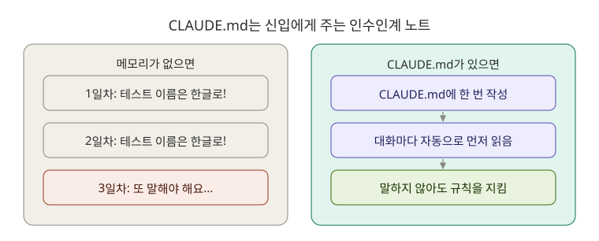
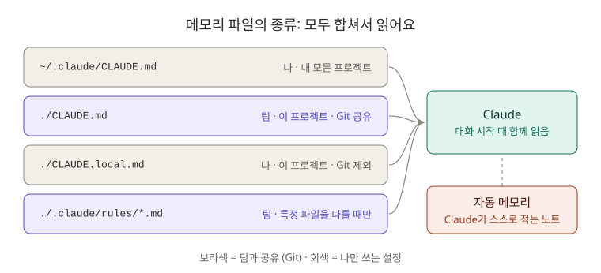

# 2장. 메모리: Claude에게 팀 규칙을 한 번만 알려 주기

**⏱ 45분** · **난이도 ⭐⭐** · **실습 비중 60%**

## 🎯 이 장을 마치면

- `CLAUDE.md`가 무엇이고 **왜 매번 같은 설명을 반복하지 않아도 되는지** 설명할 수 있어요.
- `board-api`에 팀 규칙이 담긴 `CLAUDE.md`를 만들고, Claude가 그 규칙을 따르는지 확인할 수 있어요.
- 팀 공용 규칙, 나만의 규칙, 특정 파일에만 적용하는 규칙을 구분해서 쓸 수 있어요.

---

## 🖼️ STEP 1. 그림으로 이해하기



Claude는 `/clear`를 하거나 새로 켤 때마다 **이전 대화를 잊어요.** 그래서 "우리 팀은 테스트 이름을 한글로 써요" 같은 말을 매번 다시 해야 하죠.

`CLAUDE.md`는 **신입에게 주는 인수인계 노트**예요. Claude는 대화를 시작할 때마다 이 파일을 먼저 읽어요. 한 번 적어 두면 매번 말하지 않아도 규칙을 지켜요.



---

## 📖 STEP 2. 핵심 개념

### ① 메모리 파일 4가지

| 파일 | 누구 것 | 어디에 적용 | Git에 올리나 | 예시 |
|---|---|---|---|---|
| `~/.claude/CLAUDE.md` | 나 | **내 모든 프로젝트** | ✗ | "항상 한국어로 답해" |
| `./CLAUDE.md` | 팀 | 이 프로젝트 | ✅ | 실행 명령, 패키지 구조, 코딩 규칙 |
| `./CLAUDE.local.md` | 나 | 이 프로젝트 | ✗ (`.gitignore`에 추가) | "설명은 초보자 눈높이로" |
| `./.claude/rules/*.md` | 팀 | 이 프로젝트의 **특정 파일** | ✅ | "Controller 파일에서는 이 규칙" |

> 💡 이 파일들은 하나만 골라 쓰는 게 아니라 **모두 합쳐서** 읽혀요. 그러니 같은 내용을 여러 곳에 쓰지 말고, 내용에 맞는 곳에 한 번만 쓰세요.

### ② 만들고 고치는 방법

| 방법 | 언제 |
|---|---|
| `/init` | 처음 만들 때. Claude가 프로젝트를 훑어보고 초안을 써 줘요 |
| `/memory` | 메모리 파일을 골라서 편집기로 열 때 |
| "CLAUDE.md에 추가해 줘" | 대화 중에 규칙이 생겼을 때 |
| 직접 편집 | IntelliJ, VS Code로 열어서 고치기. 그냥 마크다운 파일이에요 |

> 📝 예전에는 `#`으로 시작하는 한 줄을 입력하면 메모리에 저장됐지만 **지금은 없어진 기능**이에요. 옛날 자료에서 보면 무시하세요.

### ③ 자동 메모리 (auto memory)

`CLAUDE.md`는 **내가** 쓰는 노트고, 자동 메모리는 **Claude가 스스로** 쓰는 노트예요. "앞으로 커밋 전에 항상 테스트 돌려 줘. 기억해 줘"라고 하면 Claude가 `~/.claude/projects/<프로젝트>/memory/` 아래에 적어 두고 다음 대화에서 읽어요. `/memory`로 내용을 확인하고 끄고 켤 수 있어요.

| 이렇게 말하면 | 저장되는 곳 |
|---|---|
| "기억해 줘" | 자동 메모리 (나만 봄) |
| "CLAUDE.md에 추가해 줘" | `CLAUDE.md` (팀과 공유) |

### ④ 좋은 CLAUDE.md의 조건

| ✅ 이렇게 | ❌ 이렇게 하지 마세요 |
|---|---|
| 실행·테스트 명령처럼 **매번 필요한 것** | 코드를 읽으면 알 수 있는 것 (클래스 목록 전체) |
| "Repository를 직접 부르지 않는다"처럼 **구체적인 규칙** | "코드를 깔끔하게"처럼 애매한 말 |
| 짧게, 항목으로 | 긴 설명문. 너무 길면 Claude가 중요한 것을 놓쳐요 |
| 다른 문서는 `@docs/api.md`처럼 **가져오기** | 다른 문서 내용을 통째로 복사 |

---

## 🛠️ STEP 3. 실습 미션

### 🟢 미션 2-1. `/init`으로 초안 만들기 (10분)

```bash
cd ~/board-api
claude
```

```text
/init
```

Claude가 프로젝트를 훑어보고 `CLAUDE.md` 초안을 만들어요. 파일을 만들기 전에 권한을 물어보면 허락하세요. 만들어진 파일을 열어 **세 가지를 확인**합니다.

1. 실행 명령(`./gradlew bootRun`)과 테스트 명령(`./gradlew test`)이 맞나요?
2. 패키지 구조 설명이 실제와 같나요?
3. 틀리거나 쓸모없는 내용은 없나요?

✅ **성공 기준:** 내용을 검토하고 틀린 부분을 직접 고쳤어요. **Claude가 쓴 것을 그대로 믿지 않는 연습**이 이 미션의 핵심이에요.

### 🟢 미션 2-2. 팀 규칙 추가하고 효과 확인하기 (15분)

[templates/project-CLAUDE.md](templates/project-CLAUDE.md)의 "코딩 규칙", "테스트 규칙", "커밋 규칙"을 내 `CLAUDE.md`에 붙여넣으세요. 그다음 **효과를 비교**합니다.

```text
/clear
```

```text
댓글 목록 조회 API(GET /api/posts/{postId}/comments)를 추가하려고 해. 코드는 아직 고치지 말고, 어떤 파일을 어떻게 만들지 계획만 알려 줘.
```

✅ **성공 기준:** 계획에 "DTO record 사용", "Repository를 직접 부르지 않음", "`orElseThrow()`", "한글 테스트 이름" 같은 내 규칙이 반영돼 있어요.

> 🔍 **비교 실험 (선택):** `CLAUDE.md` 이름을 잠깐 `CLAUDE.md.bak`으로 바꾸고 `/clear` 후 같은 질문을 해 보세요. 계획이 어떻게 달라지나요? 확인했으면 이름을 되돌리세요.

### 🔵 미션 2-3. Controller 전용 규칙 만들기 (10분)

`CLAUDE.md`에 모든 규칙을 넣으면 길어져요. **특정 파일을 다룰 때만** 필요한 규칙은 `.claude/rules/`로 분리해요.

```bash
mkdir -p .claude/rules
cp ~/claude-howto/ko/02-memory/templates/rules-controller.md .claude/rules/controller.md
```

파일 맨 위의 `paths: src/main/java/**/*Controller.java`가 핵심이에요. Claude가 Controller 파일을 읽거나 고칠 때만 이 규칙을 불러와요.

```text
@src/main/java/com/example/board/post/PostController.java 이 파일이 .claude/rules/controller.md 규칙을 지키는지 검사해 줘. 고치지는 말고 결과만.
```

✅ **성공 기준:** "`@Valid`가 없다" 같은 규칙 위반을 찾아내요. 이건 3장에서 고칠 문제예요.

### 🔵 미션 2-4. 나만의 설정 만들기 (5분)

**내 모든 프로젝트**에 적용할 개인 설정을 만들어요. [templates/personal-CLAUDE.md](templates/personal-CLAUDE.md)를 참고하세요.

```bash
cp ~/claude-howto/ko/02-memory/templates/personal-CLAUDE.md ~/.claude/CLAUDE.md
```

> ⚠️ 이미 `~/.claude/CLAUDE.md`가 있다면 덮어쓰지 말고 내용을 이어 붙이세요.

✅ **성공 기준:** 다른 폴더에서 `claude`를 켜도 한국어로, 초보자 눈높이로 답해요.

### 🔴 도전 2-5. 자동 메모리 써 보기 (5분)

```text
앞으로 이 프로젝트에서 코드를 고치면 항상 ./gradlew test를 돌려서 확인해 줘. 기억해 줘.
```

`/memory`를 실행해서 자동 메모리에 무엇이 저장됐는지 확인하세요. 그리고 생각해 보세요. **이 규칙은 자동 메모리와 `CLAUDE.md` 중 어디에 있어야 할까요?** (힌트: 팀원도 지켜야 하는 규칙인가요?)

마무리로 커밋합니다.

```bash
git add CLAUDE.md .claude/rules && git commit -m "docs: 팀 규칙을 CLAUDE.md로 정리"
```

📁 **포트폴리오 결과물:** 잘 정리된 `CLAUDE.md`는 "AI 도구를 팀 단위로 쓸 줄 안다"는 증거가 돼요.

---

## ❓ STEP 4. 바로 퀴즈

**Q1.** 팀원 모두가 지켜야 하는 코딩 규칙은 어디에 적어야 할까요?

1. `~/.claude/CLAUDE.md`
2. `./CLAUDE.md`
3. `./CLAUDE.local.md`

<details>
<summary>정답 보기</summary>

**2번.** 프로젝트 폴더의 `CLAUDE.md`는 Git으로 팀과 공유돼요. 1번은 나만, 3번은 이 프로젝트에서 나만 쓰는 설정이에요.

</details>

**Q2.** `CLAUDE.local.md`를 만들었다면 함께 해야 할 일은?

<details>
<summary>정답 보기</summary>

**`.gitignore`에 추가하기.** 내 개인 설정이 팀 저장소에 올라가지 않게 해요.

</details>

**Q3.** `.claude/rules/test.md` 맨 위에 `paths: src/test/**/*.java`가 있어요. 이 규칙은 언제 적용될까요?

<details>
<summary>정답 보기</summary>

Claude가 **`src/test` 아래의 자바 파일을 읽거나 고칠 때** 불러와요. 다른 파일을 다룰 때는 읽지 않아서 대화 공간을 아껴요.

</details>

**Q4.** 대화 중에 "기억해 줘"라고 말하면 어디에 저장될까요?

<details>
<summary>정답 보기</summary>

**자동 메모리**(`~/.claude/projects/<프로젝트>/memory/`)에 저장돼요. 팀과 공유하려면 "CLAUDE.md에 추가해 줘"라고 말해야 해요.

</details>

**Q5.** 다음 중 `CLAUDE.md`에 쓰기에 **가장 알맞지 않은** 것은?

1. 테스트 실행 명령
2. "생성자 주입을 쓴다"
3. 프로젝트의 모든 클래스 이름 목록
4. 커밋 메시지 형식

<details>
<summary>정답 보기</summary>

**3번.** Claude가 코드를 읽으면 알 수 있는 내용이고, 코드가 바뀌면 금방 틀린 정보가 돼요.

</details>

---

## 🏢 STEP 5. 현장 레시피

**처음 들어간 팀 프로젝트에 CLAUDE.md가 없을 때:**

```text
/init 으로 만든 CLAUDE.md를 검토해 줘. 실제 build.gradle, application.yml과 다른 내용이 있으면 알려 주고, 우리 코드에서 반복되는 규칙(예외 처리, 응답 형식, 테스트 방식)을 찾아서 추가할 후보로 제안해 줘.
```

**코드 리뷰에서 같은 지적을 두 번 받았을 때:**

```text
방금 리뷰에서 "Controller에서 Repository를 직접 부르지 마세요"라는 지적을 받았어. 이 규칙을 CLAUDE.md의 코딩 규칙에 한 줄로 추가해 줘.
```

**CLAUDE.md가 너무 길어졌을 때:**

```text
CLAUDE.md를 검토해서 코드를 읽으면 알 수 있는 내용, 중복된 내용, 애매한 규칙을 찾아 줘. 특정 파일에만 필요한 규칙은 .claude/rules/로 옮기는 안도 제안해 줘.
```

---

## 🎤 STEP 6. 면접 한마디

> "AI 도구를 쓸 때 팀 규칙을 매번 설명하지 않도록 CLAUDE.md에 실행 방법, 계층 규칙, 테스트·커밋 규칙을 정리했습니다. 코드 리뷰에서 반복되는 지적은 규칙으로 옮겨서 같은 실수가 다시 나오지 않게 했습니다."

---

## ✅ 마무리 체크

- [ ] `/init`으로 만든 초안을 검토하고 고쳤다
- [ ] 팀 규칙을 추가하고, Claude의 계획에 규칙이 반영되는 것을 확인했다
- [ ] `.claude/rules/controller.md`로 파일별 규칙을 만들었다
- [ ] `~/.claude/CLAUDE.md`에 개인 설정을 만들었다
- [ ] 자동 메모리와 `CLAUDE.md`의 차이를 설명할 수 있다
- [ ] 퀴즈 5문제를 모두 맞혔다

**다음 장 → [8장. 체크포인트와 안전장치](../08-checkpoints/README.md)**

## 📚 더 알아보기

- 메모리 계층 전체, `AGENTS.md`, `@` 가져오기 규칙, 관리자 정책: [원문 2장](../../02-memory/README.md)
- 공식 문서: [Memory](https://code.claude.com/docs/en/memory)
