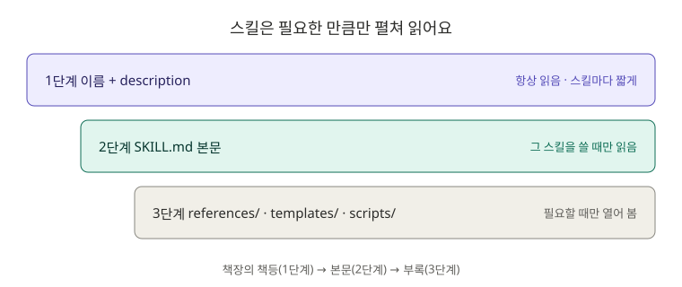
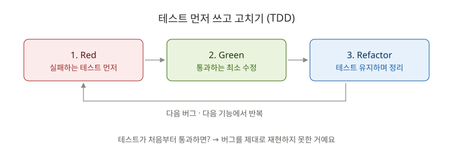

# 3장. 스킬: 나만의 업무 매뉴얼 만들기

**⏱ 1시간 30분** · **난이도 ⭐⭐** · **실습 비중 65%**

## 🎯 이 장을 마치면

- 1장의 "단축 명령"을 넘어, Claude가 **알아서 꺼내 쓰는 업무 매뉴얼**을 만들 수 있어요.
- 스킬 폴더에 **참고 문서와 템플릿**을 함께 넣어 결과물의 품질을 일정하게 만들 수 있어요.
- 스킬로 `board-api`에 **테스트를 만들고**, **테스트를 먼저 쓰는 방식(TDD)** 으로 버그를 고쳐요.

---

## 🖼️ STEP 1. 그림으로 이해하기



> 🧩 **비유:** 회사 업무 매뉴얼 책장을 떠올려 보세요. Claude는 평소에 **책등의 제목(description)** 만 봐요. 일이 들어오면 맞는 매뉴얼을 꺼내 **본문(SKILL.md)** 을 읽고, 필요할 때만 **부록(참고 문서, 템플릿)** 을 펼쳐요. 그래서 스킬을 많이 만들어도 Claude의 기억 공간을 크게 차지하지 않아요.



---

## 📖 STEP 2. 핵심 개념

### ① 1장의 명령과 무엇이 다른가요?

1장에서 만든 것도 스킬이에요. 이 장에서는 스킬의 나머지 절반을 배워요.

| | 1장에서 쓴 방식 | 이 장에서 배우는 것 |
|---|---|---|
| 누가 실행하나 | 내가 `/이름` 입력 | **Claude가 상황을 보고 알아서** 꺼내 씀 (물론 `/이름`도 됨) |
| 파일 | `SKILL.md` 하나 | `SKILL.md` + 참고 문서 + 템플릿 + 스크립트 |
| 핵심 | 본문의 작업 지시 | **`description`** 을 잘 쓰는 것 |

### ② description이 스킬의 운명을 정해요

Claude는 description만 보고 "지금 이 스킬을 쓸까?"를 판단해요. **무엇을 하는지 + 언제 쓰는지 + 사용자가 할 법한 말**을 함께 쓰세요.

| ❌ 애매한 description | ✅ 좋은 description |
|---|---|
| `테스트 도우미` | `Spring Boot 코드의 테스트를 작성하거나 버그를 TDD로 고친다. "테스트 만들어 줘", "TDD로 고쳐 줘" 같은 요청에 사용한다.` |

### ③ 스킬 폴더 구조

```text
.claude/skills/spring-test-writer/
├── SKILL.md                        ← 작업 순서 (짧게, 500줄 이내)
├── references/
│   └── test-conventions.md         ← 팀의 테스트 규칙 (필요할 때만 읽음)
└── templates/
    └── ApiTestTemplate.java        ← 결과물 형식 예시
```

`SKILL.md`에서 `[references/test-conventions.md](references/test-conventions.md)`처럼 **상대 경로로 링크**하면 Claude가 필요할 때 열어 봐요.

### ④ 누가 실행할 수 있게 할까

| 프런트매터 설정 | 내가 `/이름`으로 | Claude가 알아서 | 이럴 때 |
|---|---|---|---|
| (기본) | ✅ | ✅ | 테스트 작성, 코드 설명처럼 **안전한 일** |
| `disable-model-invocation: true` | ✅ | ✗ | 커밋, 배포처럼 **되돌리기 어려운 일** |
| `user-invocable: false` | ✗ | ✅ | 명령이 아닌 **배경지식** (예: 레거시 시스템 설명) |

### ⑤ 스킬은 어디에 둘까

| 위치 | 적용 범위 |
|---|---|
| `~/.claude/skills/이름/` | 내 모든 프로젝트 |
| `.claude/skills/이름/` | 이 프로젝트 (Git으로 팀과 공유) |

이름이 같으면 **개인(`~/.claude`) 스킬이 이겨요.** 스킬을 고친 뒤 반영이 안 되면 `/reload-skills`를 실행하세요.

### ⑥ TDD: 테스트를 먼저 쓰는 이유

버그를 고칠 때 **"버그가 있음을 증명하는 테스트"를 먼저** 쓰면 세 가지가 좋아요.

1. 버그를 정확히 이해했는지 확인돼요 (테스트가 실패해야 정상).
2. 고친 뒤 정말 고쳐졌는지 자동으로 확인돼요.
3. 나중에 같은 버그가 다시 생기면 테스트가 잡아 줘요.

---

## 🛠️ STEP 3. 실습 미션

### 🟢 미션 3-1. 스킬 설치하고 Claude가 알아서 쓰는지 보기 (10분)

```bash
cd ~/board-api
cp -r ~/claude-howto/ko/03-skills/skills/spring-test-writer .claude/skills/
```

Claude Code를 켜고(이미 켜져 있으면 `/reload-skills`) **슬래시 명령 없이** 부탁하세요.

```text
게시글 API에 테스트가 거의 없어. 테스트 좀 만들어 줘.
```

✅ **성공 기준:** Claude가 `spring-test-writer` 스킬을 쓰겠다고 표시하고, 스킬의 2단계대로 **테스트 목록을 먼저 보여 주며 확인을 받아요.**

<details>
<summary>❌ 스킬을 안 쓰고 그냥 테스트를 만들어요</summary>

- `/skills`로 목록에 `spring-test-writer`가 있는지 확인하세요.
- `/reload-skills`를 실행하고 다시 부탁해 보세요.
- 그래도 안 되면 `/spring-test-writer PostController`로 직접 부르세요. Claude가 알아서 고를지는 description에 크게 좌우돼요. 도전 3-5에서 다듬어 봐요.

</details>

### 🟢 미션 3-2. 게시글 API 테스트 만들기 (20분)

미션 3-1에서 이어서, Claude가 제안한 테스트 목록을 검토하세요. **이 세 가지는 꼭 들어가게** 하세요.

- 게시글 목록 조회 → 200
- 없는 게시글 조회 → 404 (1장에서 고친 것)
- 게시글 작성 → 201

목록에 동의하면 테스트를 만들고 실행하게 하세요.

✅ **성공 기준:** `./gradlew test`가 통과하고, 테스트 이름이 한글로 무엇을 검증하는지 드러나요. 📁 숨은 문제 **2번(테스트 없음)** 해결!

```bash
git add . && git commit -m "test: 게시글 API 테스트 추가"
```

### 🔵 미션 3-3. TDD로 빈 제목 버그 고치기 (20분)

숨은 문제 **3번**이에요. 먼저 버그를 눈으로 확인합니다. 서버를 켜고:

```bash
curl -i -X POST http://localhost:8080/api/posts -H "Content-Type: application/json" -d '{"title":"","content":"내용","authorId":1}'
```

`201 Created`가 나와요. 제목이 없는데 저장됐어요. 이제 **테스트 먼저** 방식으로 고칩니다.

```text
/spring-test-writer 제목이나 내용이 비어 있는 게시글이 저장되는 버그. 400을 돌려줘야 해. TDD로 고쳐 줘.
```

Claude가 진행하는 순서를 지켜보세요.

1. 🔴 **Red**: 실패하는 테스트를 먼저 쓰고 실행 → **실패를 보여 주나요?**
2. 🟢 **Green**: `@NotBlank`, `@Valid` 등으로 고치고 실행 → 통과
3. 전체 테스트 실행 → 모두 통과

✅ **성공 기준:** 실패 → 통과 과정을 눈으로 봤고, 같은 `curl`이 이제 `400`을 돌려줘요. 아래 질문에 답할 수 있어요.

- `@Valid`를 빼면 어떻게 될까요?
- 수정(`PUT`) API에도 검증이 적용됐나요?

<details>
<summary>🔍 막혔을 때 힌트</summary>

- 요청 DTO(`PostRequest`)의 필드에 `@NotBlank`를 붙이고, Controller의 `@RequestBody` 앞에 `@Valid`를 붙여요.
- 검증에 실패하면 `MethodArgumentNotValidException`이 나요. 1장에서 만든 `@RestControllerAdvice`에서 이 예외를 400으로 바꾸면 응답 형식이 통일돼요.
- `build.gradle`에 `spring-boot-starter-validation`은 이미 들어 있어요.

</details>

### 🔵 미션 3-4. PR 설명 스킬 써 보기 (10분)

5장에서 PR을 올릴 때 쓸 스킬이에요. 설치만 하고 구조를 살펴보세요.

```bash
cp -r ~/claude-howto/ko/03-skills/skills/pr-description .claude/skills/
```

[skills/pr-description/SKILL.md](skills/pr-description/SKILL.md)를 열고 Claude에게 물어보세요.

```text
@.claude/skills/pr-description/SKILL.md 이 스킬에서 disable-model-invocation을 true로 한 이유와 !` ` 부분이 하는 일을 설명해 줘.
```

✅ **성공 기준:** 이 스킬이 "작성만 하고 PR은 만들지 않도록" 설계된 이유를 설명할 수 있어요.

### 🔴 도전 3-5. 나만의 스킬 만들기 (20분)

1~3장을 하면서 **두 번 이상 한 부탁**을 떠올려 보세요. 없다면 아래 중 하나를 골라 만들어 보세요.

| 아이디어 | 설명 |
|---|---|
| `entity-to-dto` | Entity를 받아 요청/응답 DTO record를 만든다 |
| `api-add` | 새 API를 Controller → Service → Repository → 테스트 순서로 추가한다 |
| `interview-prep` | 방금 한 작업에서 면접 질문 5개와 모범 답안을 만든다 |

만든 뒤에는 **description만 바꿔 가며** Claude가 알아서 쓰는지 실험해 보세요.

✅ **성공 기준:** 슬래시 명령 없이 부탁했을 때 Claude가 내 스킬을 골라 써요.

---

## ❓ STEP 4. 바로 퀴즈

**Q1.** Claude가 스킬을 **알아서** 쓸지 판단할 때 가장 중요하게 보는 것은?

<details>
<summary>정답 보기</summary>

**프런트매터의 `description`.** 평소에는 이것만 읽어요.

</details>

**Q2.** 스킬을 20개 만들어도 Claude의 기억 공간을 크게 차지하지 않는 이유는?

<details>
<summary>정답 보기</summary>

평소에는 **이름과 description만** 읽고, 본문(SKILL.md)은 그 스킬을 쓸 때, 부속 파일은 필요할 때만 읽기 때문이에요. 단, description은 매번 읽히니 짧고 정확하게 쓰세요.

</details>

**Q3.** `/deploy` 스킬을 Claude가 "코드가 준비된 것 같으니 배포할게요"라며 알아서 실행하면 곤란해요. 어떤 설정이 필요할까요?

<details>
<summary>정답 보기</summary>

**`disable-model-invocation: true`.** 내가 `/deploy`를 입력할 때만 실행돼요.

</details>

**Q4.** TDD로 버그를 고칠 때 새로 쓴 테스트가 **처음부터 통과**했어요. 무엇을 의심해야 할까요?

<details>
<summary>정답 보기</summary>

**테스트가 버그를 제대로 재현하지 못하고 있다**는 뜻이에요. 버그를 정확히 이해했는지, 테스트의 요청과 기대값이 맞는지 다시 확인하세요.

</details>

**Q5.** `~/.claude/skills/review/`와 `.claude/skills/review/`가 둘 다 있으면 `/review`는 어느 것을 실행할까요?

<details>
<summary>정답 보기</summary>

**개인 스킬(`~/.claude/skills/review/`).** 이름이 같으면 개인 스킬이 프로젝트 스킬보다 우선해요. 헷갈리지 않게 이름을 다르게 짓는 게 좋아요.

</details>

---

## 🏢 STEP 5. 현장 레시피

**팀의 반복 업무를 스킬로 만드는 순서:**

```text
1. 같은 부탁을 3번 했다 → 스킬 후보
2. 지난 대화에서 잘 됐던 부탁을 SKILL.md 본문으로 옮긴다
3. 팀 규칙·예시는 references/, 결과물 형식은 templates/로 분리
4. description에 "사용자가 할 법한 말"을 넣는다
5. .claude/skills/에 두고 커밋 → 팀원 모두 사용
```

**Claude에게 스킬 초안을 맡기기:**

```text
방금 우리가 한 "테스트 먼저 쓰고 버그 고치기" 과정을 .claude/skills/ 아래 스킬로 만들어 줘. description에는 언제 써야 하는지와 사용자가 할 법한 말을 넣어 줘.
```

---

## 🎤 STEP 6. 면접 한마디

> "버그를 고칠 때는 먼저 버그를 재현하는 실패 테스트를 쓰고, 통과시키는 최소한의 수정을 한 뒤 전체 테스트로 확인했습니다. 이 과정을 팀 규칙과 함께 Claude Code 스킬로 만들어서 누가 고쳐도 같은 순서를 지키게 했습니다."

**예상 꼬리 질문:** "`@SpringBootTest`와 `@WebMvcTest`의 차이는?" → `/explain`으로 정리해 두세요.

---

## ✅ 마무리 체크

- [ ] `spring-test-writer` 스킬을 Claude가 알아서 쓰는 것을 확인했다
- [ ] 게시글 API 테스트를 만들고 커밋했다 (숨은 문제 2번 ✔)
- [ ] 빈 제목 버그를 실패 → 통과 순서로 고쳤다 (숨은 문제 3번 ✔)
- [ ] `disable-model-invocation`과 `user-invocable`의 차이를 설명할 수 있다
- [ ] 나만의 스킬을 하나 만들었다
- [ ] 퀴즈 5문제를 모두 맞혔다

**다음 장 → [6장. 훅](../06-hooks/README.md)**

## 📚 더 알아보기

- 프런트매터 전체 옵션, `context: fork`, 스킬 관리: [원문 3장](../../03-skills/README.md)
- 공식 문서: [Skills](https://code.claude.com/docs/en/skills)
