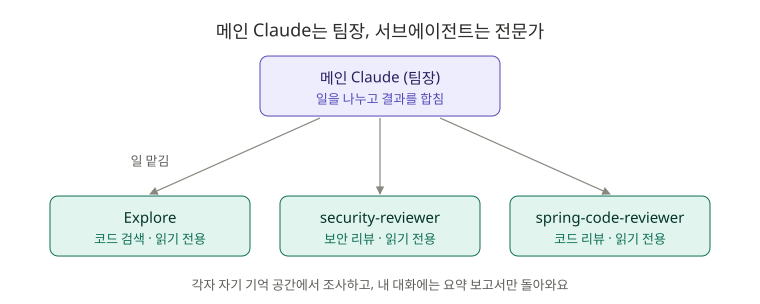

# 4장. 서브에이전트: 일을 나눠 맡기는 전문가 팀

**⏱ 1시간 30분** · **난이도 ⭐⭐⭐** · **실습 비중 65%**

## 🎯 이 장을 마치면

- 서브에이전트가 무엇이고, **왜 대화를 깨끗하게 유지해 주는지** 설명할 수 있어요.
- **보안 리뷰어**를 시켜 `board-api`의 비밀번호 저장 문제를 찾고 고칠 수 있어요.
- 리뷰어 여러 명에게 **동시에** 리뷰를 맡길 수 있어요.

---

## 🖼️ STEP 1. 그림으로 이해하기



> 🧩 **비유:** 지금까지 Claude는 **혼자 모든 일을 하는 신입**이었어요. 서브에이전트를 쓰면 Claude가 **팀장**이 되고, 보안 담당·코드 리뷰 담당 같은 **전문가에게 일을 나눠 줘요.** 전문가는 자기 책상(별도의 기억 공간)에서 조사한 뒤 **요약 보고서만** 팀장에게 올려요. 그래서 팀장의 책상(내 대화)은 어지러워지지 않아요.

| | 메인 Claude에게 직접 시키기 | 서브에이전트에게 맡기기 |
|---|---|---|
| 조사 과정 | 내 대화에 전부 쌓임 | 서브에이전트의 공간에만 쌓임 |
| 내 대화에 남는 것 | 읽은 파일, 중간 과정 전부 | **결과 요약만** |
| 역할 | 무엇이든 | 정해진 역할과 정해진 도구만 |

---

## 📖 STEP 2. 핵심 개념

### ① 이미 들어 있는 서브에이전트

| 이름 | 하는 일 |
|---|---|
| **Explore** | 코드 검색·분석 전용. **읽기만** 해요 |
| **Plan** | 계획 모드에서 계획을 세우기 전에 코드를 조사해요 |
| **general-purpose** | 여러 단계가 필요한 복잡한 일 |

"Explore 에이전트로 찾아 줘"처럼 이름을 말하면 그 에이전트에게 맡겨요.

### ② 나만의 서브에이전트 = 마크다운 파일 하나

```yaml
---
name: security-reviewer
description: 보안 문제를 찾는 읽기 전용 리뷰어. 회원·비밀번호 관련 코드를 바꿨을 때 사용한다.
tools: Read, Grep, Glob
model: inherit
---

당신은 Spring Boot 백엔드의 보안 리뷰어입니다. 코드를 읽기만 하고 고치지 않습니다.
(검사 항목과 보고 형식...)
```

| 항목 | 뜻 |
|---|---|
| `name` | 에이전트 이름 (소문자와 하이픈) |
| `description` | **언제 이 에이전트에게 맡길지.** 스킬처럼 Claude가 이걸 보고 판단해요 |
| `tools` | 쓸 수 있는 도구. 생략하면 전부. **리뷰어는 읽기 도구만** 주는 게 안전해요 |
| `model` | 사용할 모델. `inherit`는 메인과 같은 모델 |
| 본문 | 이 에이전트의 **역할 설명서** (시스템 프롬프트) |

| 위치 | 적용 범위 |
|---|---|
| `.claude/agents/이름.md` | 이 프로젝트 (팀과 공유) |
| `~/.claude/agents/이름.md` | 내 모든 프로젝트 |

> 📝 예전에는 `/agents` 명령으로 마법사를 열어 만들었지만 지금은 없어졌어요. **Claude에게 "서브에이전트 만들어 줘"라고 부탁하거나 파일을 직접 만드세요.**

### ③ 부르는 방법

| 방법 | 예시 |
|---|---|
| 알아서 | description에 맞는 일이면 Claude가 스스로 맡겨요 |
| 이름으로 부탁 | "security-reviewer 에이전트에게 회원 기능을 검토시켜 줘" |
| `@`로 확실하게 | `@` 입력 후 목록에서 에이전트 선택 |

### ④ 스킬 vs 서브에이전트

| | 스킬 (3장) | 서브에이전트 |
|---|---|---|
| 비유 | **업무 매뉴얼** | **다른 팀원** |
| 기억 공간 | 메인 대화 안에서 실행 | **따로** 실행하고 결과만 보고 |
| 잘 맞는 일 | 정해진 순서가 있는 작업 | 많이 읽어야 하는 조사, 독립적인 리뷰 |

> ⚠️ 서브에이전트가 **고친 파일은 체크포인트(8장)로 되돌릴 수 없어요.** 그래서 이 장의 리뷰어들은 읽기 전용으로 만들고, 실제 수정은 메인 Claude에게 맡겨요.

---

## 🛠️ STEP 3. 실습 미션

### 🟢 미션 4-1. Explore 에이전트로 조사 맡기기 (10분)

```text
Explore 에이전트를 써서, 이 프로젝트에서 @Transactional이 붙은 곳을 모두 찾고 readOnly 여부를 표로 정리해 줘.
```

진행 화면에 Explore 에이전트가 따로 일하는 모습이 보여요. 끝난 뒤 내 대화에는 **결과 표만** 남아요.

✅ **성공 기준:** Explore가 조사하고, 메인 Claude가 결과만 받아서 정리했어요.

### 🟢 미션 4-2. 보안 리뷰어 데려오기 (15분)

```bash
cd ~/board-api
mkdir -p .claude/agents
cp ~/claude-howto/ko/04-subagents/agents/security-reviewer.md .claude/agents/
```

파일을 열어 `tools: Read, Grep, Glob`을 확인하세요. **코드를 고칠 수 없는** 리뷰어예요. Claude Code를 다시 켜고 부탁합니다.

```text
security-reviewer 에이전트에게 회원(member) 기능의 보안 검토를 맡겨 줘.
```

✅ **성공 기준:** 🔴 높음으로 **"비밀번호를 평문으로 저장"** 이 보고돼요. 📁 숨은 문제 **4번** 발견!

### 🔵 미션 4-3. 리뷰 결과로 고치기 (25분)

리뷰어는 찾기만 했어요. 고치는 건 메인 Claude의 일이에요. 3장의 테스트 스킬과 함께 써 봅니다.

```text
보안 리뷰에서 나온 비밀번호 평문 저장 문제를 고쳐 줘. BCrypt로 해시해서 저장하고, Spring Security 전체 대신 spring-security-crypto만 추가해 줘. spring-test-writer 스킬로 "비밀번호가 해시되어 저장되는지" 테스트를 먼저 만들어 줘.
```

`build.gradle`을 고치려고 하면 6장의 확인 훅이 뜰 수 있어요. 바뀌는 의존성을 확인하고 허락하세요.

✅ **성공 기준:** 테스트가 통과하고, 아래 질문에 답할 수 있어요.

- 해시와 암호화는 뭐가 다른가요?
- 같은 비밀번호를 두 번 해시하면 결과가 같을까요? (힌트: 솔트)

```text
/explain BCrypt와 솔트
```

다시 리뷰를 맡겨 확인합니다.

```text
security-reviewer 에이전트에게 회원 기능을 다시 검토시켜 줘. 비밀번호 문제가 해결됐는지 확인해 줘.
```

```bash
git add . && git commit -m "fix: 회원 비밀번호를 BCrypt로 해시해서 저장"
```

### 🔵 미션 4-4. 리뷰어 두 명에게 동시에 맡기기 (15분)

```bash
cp ~/claude-howto/ko/04-subagents/agents/spring-code-reviewer.md .claude/agents/
```

```text
security-reviewer와 spring-code-reviewer 에이전트에게 지금까지 커밋한 전체 코드를 동시에 리뷰시키고, 두 결과를 합쳐서 "꼭 고칠 것"만 우선순위대로 정리해 줘.
```

✅ **성공 기준:** 두 에이전트가 동시에 일하고, 메인 Claude가 결과를 합쳐요. "꼭 고칠 것" 중에 **게시글 목록의 N+1** 이 보이면 잘 찾은 거예요. 그건 9장에서 고쳐요.

### 🔴 도전 4-5. Claude에게 서브에이전트 만들게 하기 (15분)

```text
JPA 성능 문제(N+1, 불필요한 조회, 잘못된 fetch 전략)만 찾는 읽기 전용 서브에이전트를 .claude/agents/jpa-performance-reviewer.md로 만들어 줘. 도구는 Read, Grep, Glob만 주고, 보고 형식은 security-reviewer와 비슷하게.
```

만들어진 파일을 **반드시 읽어 보고**, 마음에 안 드는 부분을 고친 뒤 실행해 보세요.

✅ **성공 기준:** 새 에이전트가 `PostService.findAll()`의 N+1 위험을 찾아요.

---

## ❓ STEP 4. 바로 퀴즈

**Q1.** 서브에이전트를 쓰면 메인 대화가 깨끗하게 유지되는 이유는?

<details>
<summary>정답 보기</summary>

서브에이전트는 **자기만의 기억 공간**에서 파일을 읽고 조사한 뒤, **결과 요약만** 메인 대화에 돌려주기 때문이에요.

</details>

**Q2.** 리뷰 전용 에이전트의 `tools`를 `Read, Grep, Glob`으로 제한하는 이유는?

<details>
<summary>정답 보기</summary>

리뷰어가 **실수로 코드를 고치지 못하게** 하려는 거예요. 게다가 서브에이전트가 고친 파일은 체크포인트로 되돌릴 수 없어요.

</details>

**Q3.** 팀원 모두가 같은 리뷰어를 쓰게 하려면 에이전트 파일을 어디에 둬야 할까요?

<details>
<summary>정답 보기</summary>

**`.claude/agents/`** 에 두고 Git에 커밋해요. `~/.claude/agents/`는 나만 써요.

</details>

**Q4.** 다음 중 서브에이전트보다 **스킬**이 더 알맞은 일은?

1. 프로젝트 전체에서 보안 문제 찾기
2. 정해진 형식으로 커밋 메시지 쓰기
3. 수백 개 파일에서 특정 패턴 찾기

<details>
<summary>정답 보기</summary>

**2번.** 정해진 순서와 형식이 있는 짧은 작업은 스킬이 좋아요. 1, 3번은 많이 읽어야 하는 독립 조사라서 서브에이전트가 좋아요.

</details>

**Q5.** 지금 Claude Code에서 서브에이전트를 새로 만드는 방법 두 가지는?

<details>
<summary>정답 보기</summary>

1. Claude에게 **"서브에이전트 만들어 줘"** 라고 부탁하기
2. `.claude/agents/이름.md` 파일을 **직접 만들기**

(예전의 `/agents` 마법사는 없어졌어요.)

</details>

---

## 🏢 STEP 5. 현장 레시피

**PR 올리기 전 셀프 리뷰 세트:**

```text
spring-code-reviewer와 security-reviewer에게 git diff main...HEAD를 동시에 리뷰시켜 줘. "꼭 고칠 것"이 있으면 하나씩 고치고, 고칠 때마다 ./gradlew test로 확인해 줘.
```

**처음 보는 대형 프로젝트 파악:**

```text
Explore 에이전트 3개를 동시에 써서 (1) 인증 흐름 (2) 주문 처리 흐름 (3) 외부 API 연동 부분을 각각 조사하고, 신입용 안내 문서 하나로 합쳐 줘.
```

**팀에 두면 좋은 에이전트 아이디어:** `test-runner`(실패한 테스트 원인 분석), `api-doc-writer`(API 문서 갱신), `migration-checker`(DB 스키마 변경 검토)

---

## 🎤 STEP 6. 면접 한마디

> "보안 리뷰와 코드 리뷰를 읽기 전용 서브에이전트로 분리해서, 리뷰어는 문제를 찾기만 하고 수정은 테스트와 함께 따로 진행했습니다. 이 과정에서 비밀번호가 평문으로 저장되던 문제를 발견해 BCrypt 해시로 바꿨습니다."

**예상 꼬리 질문:** "비밀번호를 왜 암호화가 아니라 해시로 저장하나요?"

---

## ✅ 마무리 체크

- [ ] Explore 에이전트에게 조사를 맡겨 봤다
- [ ] security-reviewer로 비밀번호 평문 저장을 찾았다
- [ ] BCrypt로 고치고 테스트까지 통과했다 (숨은 문제 4번 ✔)
- [ ] 리뷰어 두 명에게 동시에 리뷰를 맡겼다
- [ ] 스킬과 서브에이전트의 차이를 설명할 수 있다
- [ ] 퀴즈 5문제를 모두 맞혔다

**다음 장 → [5장. MCP](../05-mcp/README.md)**

## 📚 더 알아보기

- 설정 항목 전체, 백그라운드 실행, worktree 격리, 에이전트 팀: [원문 4장](../../04-subagents/README.md)
- 공식 문서: [Subagents](https://code.claude.com/docs/en/sub-agents)
