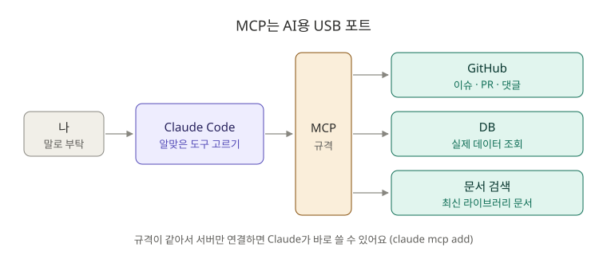
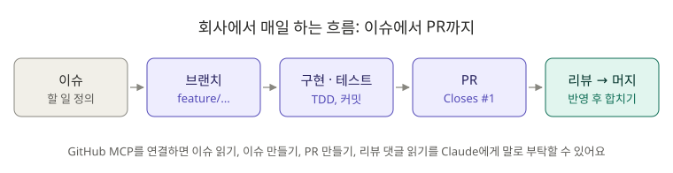

# 5장. MCP: GitHub와 연결해서 실무 흐름 따라 하기

**⏱ 1시간** · **난이도 ⭐⭐⭐** · **실습 비중 70%**

## 🎯 이 장을 마치면

- MCP가 무엇이고 **왜 "AI용 USB 포트"라고 부르는지** 설명할 수 있어요.
- Claude Code를 **GitHub에 연결**해서 이슈를 읽고, 만들고, PR을 올릴 수 있어요.
- 회사에서 하는 **이슈 → 브랜치 → 구현 → PR → 리뷰 반영** 흐름을 한 번 끝까지 경험해요.

---

## 🖼️ STEP 1. 그림으로 이해하기



> 🧩 **비유:** MCP는 **USB 포트**예요. 컴퓨터에 USB 규격이 있어서 마우스든 키보드든 꽂기만 하면 되듯, Claude에 MCP 규격이 있어서 GitHub, DB, 문서 검색 같은 **외부 서비스를 꽂기만 하면** Claude가 쓸 수 있어요.



---

## 📖 STEP 2. 핵심 개념

### ① 메모리와 MCP의 차이

| | 메모리 (2장) | MCP |
|---|---|---|
| 담는 것 | 잘 안 바뀌는 규칙 | **지금 이 순간의** 외부 데이터 |
| 예시 | "테스트 이름은 한글로" | "GitHub에 열려 있는 이슈 목록", "DB의 실제 데이터" |

### ② 연결 명령

```bash
# 인터넷에 있는 MCP 서버 연결 (HTTP 방식, 추천)
claude mcp add --transport http 이름 https://서버주소

# 내 컴퓨터에서 실행하는 MCP 서버 연결 (stdio 방식)
claude mcp add --transport stdio 이름 -- 실행할명령
```

| 확인 방법 | 하는 일 |
|---|---|
| `claude mcp list` | 연결된 서버 목록 (터미널) |
| `/mcp` | 연결 상태 확인, 로그인 (Claude Code 안) |

### ③ 어디에 저장할까 (scope)

| scope | 저장 위치 | 공유 | 언제 |
|---|---|---|---|
| `local` (기본값) | 내 설정 파일, 이 프로젝트만 | 나만 | **토큰이 들어가는 설정** |
| `project` | 프로젝트의 `.mcp.json` | 팀 (Git) | 팀 모두 쓰는 서버. 토큰은 `${환경변수}`로 |
| `user` | 내 설정 파일, 모든 프로젝트 | 나만 | 어디서나 쓰는 서버 |

> ⚠️ **토큰은 비밀번호와 같아요.** `.mcp.json`에 토큰을 직접 쓰고 커밋하면 GitHub에 그대로 공개돼요. 이 장에서는 `local` scope를 써요.

### ④ MCP로 할 수 있는 일 (GitHub 예시)

이슈 목록·내용 읽기, 이슈 만들기, 댓글 달기, PR 만들기, PR 리뷰 댓글 읽기 등. Claude에게 **말로 부탁하면** 알맞은 MCP 도구를 골라 써요.

---

## 🛠️ STEP 3. 실습 미션

### 🟢 미션 5-1. board-api를 GitHub에 올리기 (10분)

1. [GitHub](https://github.com/new)에서 새 저장소 `board-api`를 만드세요. **README 추가 등은 체크하지 마세요.** (빈 저장소)
2. 내 프로젝트를 연결해서 올립니다. `내아이디`를 바꿔 쓰세요.

```bash
cd ~/board-api
git branch -M main
git remote add origin https://github.com/내아이디/board-api.git
git push -u origin main
```

처음 푸시할 때 로그인 창이 뜨면 GitHub 계정으로 로그인하세요.

✅ **성공 기준:** GitHub 저장소 페이지에 내 코드가 보여요. 📁 **포트폴리오 저장소**가 생겼어요!

### 🟢 미션 5-2. GitHub 토큰 발급하고 MCP 연결하기 (15분)

1. GitHub → 오른쪽 위 프로필 → **Settings → Developer settings → Personal access tokens → Fine-grained tokens → Generate new token**
2. 설정:
   - Repository access: **Only select repositories** → `board-api`
   - Permissions: **Issues** Read and write, **Pull requests** Read and write, **Contents** Read-only
3. 만들어진 토큰을 복사해서 **한 번만** 아래 명령에 넣어 실행하세요. 토큰은 다시 볼 수 없으니 잃어버리면 새로 만들어야 해요.

```bash
claude mcp add --transport http github https://api.githubcopilot.com/mcp/ --header "Authorization: Bearer 여기에_토큰_붙여넣기"
```

```bash
claude mcp list
```

✅ **성공 기준:** 목록에 `github`이 연결됨(✓ Connected)으로 나와요. Claude Code 안에서 `/mcp`로도 확인해 보세요.

> ⚠️ 토큰을 채팅창이나 코드에 붙여넣지 마세요. 실수로 노출됐다면 GitHub에서 바로 **삭제(Revoke)** 하고 새로 만드세요.

### 🔵 미션 5-3. Claude에게 이슈 만들게 하기 (10분)

2장에서 계획만 세웠던 **댓글 목록 조회 API**를 정식 작업으로 등록해요.

```text
GitHub의 내 board-api 저장소에 이슈를 만들어 줘.
제목: 댓글 목록 조회 API 추가
내용: GET /api/posts/{postId}/comments 로 댓글 목록을 조회한다. 응답에는 댓글 id, 내용, 작성자 이름. 게시글이 없으면 404. 테스트 포함.
```

Claude가 GitHub MCP 도구를 쓰겠다고 권한을 물어보면 허락하세요.

✅ **성공 기준:** GitHub의 Issues 탭에 이슈 #1이 생겼어요.

### 🔵 미션 5-4. 이슈부터 PR까지 (20분)

회사에서 매일 하는 흐름이에요. 한 번에 부탁하지 말고 **단계마다 확인**하세요.

```text
GitHub 이슈 #1을 읽고, feature/comment-list 브랜치를 만들어서 구현해 줘. spring-test-writer 스킬로 테스트도 만들고, 테스트가 통과하면 커밋해 줘.
```

```bash
git push -u origin feature/comment-list
```

3장에서 설치한 스킬로 PR 설명을 쓰고, PR까지 만들어요.

```text
/pr-description 1
```

```text
방금 쓴 설명으로 feature/comment-list → main PR을 GitHub에 만들어 줘.
```

✅ **성공 기준:** GitHub에 PR이 생기고, 본문의 `Closes #1` 덕분에 이슈와 연결돼요.

### 🔴 도전 5-5. PR 리뷰 반영하기 (10분)

GitHub에서 내 PR의 **Files changed** 탭을 열고, 아무 줄에나 리뷰 댓글을 하나 남겨 보세요. 예: "게시글이 없을 때 404를 확인하는 테스트도 있나요?"

```text
PR의 리뷰 댓글을 읽고 반영해 줘. 반영한 다음 커밋하고, 그 댓글에 "반영했습니다"라고 답글을 달아 줘.
```

```bash
git push
```

✅ **성공 기준:** PR에 새 커밋과 답글이 달렸어요. 확인했으면 GitHub에서 PR을 **Merge** 하세요.

```bash
git switch main && git pull
```

> 🎯 이제 [10장 CLI ② 심화](../10-cli/README.md#part-2-심화)를 할 준비가 됐어요. 학습 순서상 9장을 먼저 하고 와도 돼요.

---

## ❓ STEP 4. 바로 퀴즈

**Q1.** "GitHub에 지금 열려 있는 이슈 목록"은 메모리(CLAUDE.md)와 MCP 중 어디서 가져와야 할까요?

<details>
<summary>정답 보기</summary>

**MCP.** 계속 바뀌는 실시간 데이터예요. CLAUDE.md는 잘 바뀌지 않는 규칙을 담아요.

</details>

**Q2.** 토큰이 들어간 MCP 설정을 팀과 공유하는 `.mcp.json`에 직접 쓰면 안 되는 이유와 대안은?

<details>
<summary>정답 보기</summary>

Git에 올라가서 **토큰이 공개돼요.** 대안: 나만 쓰는 `local` scope에 저장하거나, `.mcp.json`에는 `${GITHUB_PERSONAL_ACCESS_TOKEN}`처럼 **환경 변수**로 쓰고 각자 자기 토큰을 설정해요.

</details>

**Q3.** 연결된 MCP 서버를 터미널에서 확인하는 명령은?

<details>
<summary>정답 보기</summary>

**`claude mcp list`.** Claude Code 안에서는 `/mcp`.

</details>

**Q4.** GitHub 토큰을 만들 때 권한을 필요한 것만, 필요한 저장소에만 주는 이유는?

<details>
<summary>정답 보기</summary>

토큰이 유출되거나 AI가 실수해도 **피해 범위를 줄이기 위해서**예요. 이걸 "최소 권한 원칙"이라고 해요.

</details>

**Q5.** PR 본문에 `Closes #1`을 쓰면 어떤 일이 일어나나요?

<details>
<summary>정답 보기</summary>

PR이 머지될 때 **이슈 #1이 자동으로 닫혀요.** 이슈와 PR이 연결되어 기록이 남아요.

</details>

---

## 🏢 STEP 5. 현장 레시피

**아침에 할 일 정리:**

```text
GitHub에서 나에게 할당된 이슈와 리뷰 요청이 온 PR을 모아서, 오늘 처리할 순서를 추천해 줘.
```

**버그 제보를 이슈로:**

```text
아래 에러 로그로 GitHub 이슈를 만들어 줘. 제목, 재현 방법, 예상 원인, 관련 파일을 포함해 줘.
(로그 붙여넣기)
```

**다른 MCP 서버도 연결해 보기 (선택):** 최신 라이브러리 문서를 찾아 주는 MCP 서버도 있어요. Spring Boot 4처럼 새 버전을 쓸 때 옛날 예제 때문에 생기는 실수를 줄여 줘요.

```bash
claude mcp add --transport http context7 https://mcp.context7.com/mcp
```

```text
context7로 Spring Boot 4의 MockMvc 테스트 설정 방법을 찾아서 알려 줘.
```

> 💡 MCP 서버는 누구나 만들 수 있어요. **믿을 수 있는 곳에서 만든 서버만** 연결하세요. 서버가 Claude에게 보내는 내용도 결국 Claude의 행동에 영향을 줘요.

---

## 🎤 STEP 6. 면접 한마디

> "개인 프로젝트도 이슈로 작업을 정의하고, 브랜치에서 구현한 뒤 PR로 머지하는 흐름을 지켰습니다. Claude Code를 GitHub MCP로 연결해서 이슈 내용을 바로 읽고 구현하게 했고, 토큰은 저장소와 권한을 최소로 제한해 발급했습니다."

---

## ✅ 마무리 체크

- [ ] board-api를 GitHub에 올렸다
- [ ] 최소 권한 토큰으로 GitHub MCP를 연결했다
- [ ] Claude에게 이슈를 만들게 했다
- [ ] 이슈 → 브랜치 → 구현 → PR 흐름을 끝까지 해 봤다
- [ ] PR 리뷰 댓글을 반영하고 머지했다
- [ ] 퀴즈 5문제를 모두 맞혔다

🎉 **2단계 완료!** 반복 작업을 자동화하고 실무 흐름까지 경험했어요.

**다음 장 → [9장. 고급 기능](../09-advanced-features/README.md)** (3단계 시작)

## 📚 더 알아보기

- 연결 방식, OAuth, scope, 출력 제한, 기업용 설정: [원문 5장](../../05-mcp/README.md)
- 공식 문서: [MCP](https://code.claude.com/docs/en/mcp)
