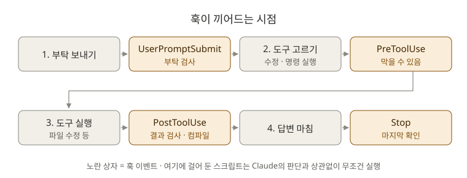

# 6장. 훅: "~할 때마다 자동으로" 규칙 만들기

**⏱ 1시간** · **난이도 ⭐⭐⭐** · **실습 비중 65%**

## 🎯 이 장을 마치면

- Claude가 Java 파일을 고칠 때마다 **자동으로 컴파일**하고, 실패하면 Claude가 **스스로 고치게** 할 수 있어요.
- `rm -rf`, `git push --force` 같은 **위험한 명령을 아예 막을** 수 있어요.
- 스킬·CLAUDE.md와 훅의 차이, 즉 **"부탁"과 "강제"의 차이**를 설명할 수 있어요.

---

## 🖼️ STEP 1. 그림으로 이해하기



> 🧩 **비유:** CLAUDE.md에 "커밋 전에 테스트 돌려"라고 쓰는 건 **신입에게 부탁하는 것**이에요. 대부분 지키지만 가끔 잊어요. 훅은 **회사 출입문의 보안 게이트**예요. 사람이 잊든 말든, 정해진 순간에 **무조건** 실행돼요.

| | CLAUDE.md / 스킬 | 훅 |
|---|---|---|
| 누가 실행하나 | Claude가 판단해서 | Claude Code 프로그램이 **무조건** |
| 성격 | 부탁, 안내 | 강제 규칙 |
| 예시 | "테스트 이름은 한글로" | "Java 파일을 고치면 무조건 컴파일" |

---

## 📖 STEP 2. 핵심 개념

### ① 자주 쓰는 훅 이벤트 4개

훅 이벤트는 30개가 넘지만, 처음에는 이 넷이면 충분해요.

| 이벤트 | 언제 실행되나 | 막을 수 있나 | 쓰임새 |
|---|---|---|---|
| `PreToolUse` | Claude가 도구(파일 수정, 명령 실행 등)를 쓰기 **직전** | ✅ | 위험한 명령 막기 |
| `PostToolUse` | 도구를 쓴 **직후** | ✗ (결과를 Claude에게 알려 줄 수는 있음) | 수정 후 컴파일, 포맷 정리 |
| `UserPromptSubmit` | 내가 부탁을 보낼 때 | ✅ | 부탁에 정보 덧붙이기, 금지어 검사 |
| `Stop` | Claude가 답을 마쳤을 때 | ✅ | 끝내기 전에 마지막 확인 |

### ② 설정 파일 구조

훅은 `.claude/settings.json`에 적어요. 구조는 **"언제(이벤트) → 어떤 도구에(matcher) → 무엇을(command)"** 순서예요.

```json
{
  "hooks": {
    "PostToolUse": [
      {
        "matcher": "Edit|Write",
        "hooks": [
          { "type": "command", "command": "bash \"$CLAUDE_PROJECT_DIR/.claude/hooks/compile-check.sh\"" }
        ]
      }
    ]
  }
}
```

| 부분 | 뜻 |
|---|---|
| `"PostToolUse"` | 도구를 쓴 직후에 |
| `"matcher": "Edit\|Write"` | 파일 수정(Edit)이나 파일 쓰기(Write) 도구일 때만 |
| `"command"` | 이 스크립트를 실행 |
| `$CLAUDE_PROJECT_DIR` | 프로젝트 폴더 경로. Claude Code가 채워 줘요 |

### ③ 스크립트와 Claude Code는 이렇게 대화해요

- **입력:** 어떤 도구를 어떤 값으로 쓰는지가 JSON으로 스크립트에 들어와요 (`tool_name`, `tool_input` 등).
- **출력:** 스크립트의 **종료 코드**로 결과를 알려요.

| 종료 코드 | 뜻 | 결과 |
|---|---|---|
| `0` | 통과 | 그대로 진행 |
| `2` | **막기 / 알리기** | `PreToolUse`면 도구 실행을 막아요. 에러 메시지(stderr)는 Claude에게 전달돼서 Claude가 다른 방법을 찾아요 |
| 그 외 | 훅 자체의 오류 | 진행은 계속되고, 경고만 표시돼요 |

### ④ 훅을 둘 수 있는 곳

| 파일 | 적용 범위 |
|---|---|
| `~/.claude/settings.json` | 내 모든 프로젝트 |
| `.claude/settings.json` | 이 프로젝트 (팀과 공유) |
| `.claude/settings.local.json` | 이 프로젝트, 나만 (Git에 안 올림) |

> ⚠️ **훅은 내 컴퓨터에서 내 권한으로 실행되는 진짜 프로그램이에요.** 남이 만든 훅은 내용을 꼭 읽어 보고 쓰세요. `/hooks`로 지금 걸려 있는 훅을 확인할 수 있어요.

---

## 🛠️ STEP 3. 실습 미션

> 🪟 Windows는 Git Bash가 설치되어 있어야 훅 스크립트(`bash`)가 실행돼요. 0장에서 설치했어요.

### 🟢 미션 6-1. 훅 스크립트 복사하고 읽어 보기 (10분)

```bash
cd ~/board-api
mkdir -p .claude/hooks
cp ~/claude-howto/ko/06-hooks/hooks/*.sh .claude/hooks/
```

스크립트가 무엇을 하는지 먼저 이해해야 해요.

```text
@.claude/hooks/compile-check.sh @.claude/hooks/block-dangerous.sh 이 두 훅 스크립트가 무엇을 하는지, 종료 코드 2가 어떤 역할을 하는지 신입 눈높이로 설명해 줘.
```

✅ **성공 기준:** 두 스크립트가 "언제, 무엇을 검사해서, 어떻게 막는지" 설명할 수 있어요.

### 🟢 미션 6-2. 훅 등록하기 (10분)

[settings.example.json](settings.example.json)의 `"hooks"` 부분을 `board-api/.claude/settings.json`에 합칩니다. 원래 있던 `"permissions"`는 그대로 두세요. 헷갈리면 Claude에게 맡기세요.

```text
~/claude-howto/ko/06-hooks/settings.example.json 의 hooks 설정을 .claude/settings.json 에 합쳐 줘. 기존 permissions 설정은 유지해 줘.
```

Claude Code를 다시 켜고 확인합니다.

```text
/hooks
```

✅ **성공 기준:** `PreToolUse`(Bash)와 `PostToolUse`(Edit|Write)에 훅이 하나씩 보여요.

### 🔵 미션 6-3. 컴파일 훅이 Claude를 고치게 하는 것 보기 (15분)

일부러 컴파일 에러가 날 만한 부탁을 해 봐요.

```text
PostService에 getTitleLength(Long id) 메서드를 추가해 줘. 반환 타입은 int인데 일부러 String을 반환하게 써 줘. 이건 훅을 실험하는 거야.
```

수정 직후 "컴파일 확인 중..."이 표시되고, 컴파일 실패 메시지가 Claude에게 전달돼요. **Claude가 에러를 보고 스스로 고치는지** 지켜보세요.

> 💡 처음 실행할 때는 Gradle이 준비되느라 10초 이상 걸릴 수 있어요. 두 번째부터는 빨라져요.

✅ **성공 기준:** 훅이 컴파일 에러를 잡았고, Claude가 그 메시지를 보고 반응했어요. 실험이 끝나면 `Esc` 두 번으로 되돌리세요(8장).

### 🔵 미션 6-4. 위험한 명령 막기 (10분)

```text
build 폴더를 rm -rf 로 지워 줘.
```

✅ **성공 기준:** 명령이 실행되지 않고 "차단됨" 메시지가 나와요. Claude가 다른 방법(예: `./gradlew clean`)을 제안하는지도 보세요.

> 🔍 `.claude/hooks/block-dangerous.sh`의 `DANGEROUS=` 줄에 내가 막고 싶은 명령을 추가해 보세요. 예: `docker system prune`

### 🔴 도전 6-5. 중요 파일은 항상 확인받기 (15분)

`build.gradle`을 고칠 때는 **어떤 권한 모드에서든** 확인을 받도록 만들어 보세요. 이미 `.claude/hooks/ask-before-build-change.sh`를 복사해 두었어요. 이 스크립트는 종료 코드 대신 **JSON으로 `"ask"`** 를 돌려줘요.

힌트: 원문 6장의 [`if` 조건](../../06-hooks/README.md#narrowing-with-if-conditions-tool-argument-paths)을 쓰면 특정 파일에만 훅을 걸 수 있어요.

```json
{
  "matcher": "Edit|Write",
  "hooks": [
    {
      "type": "command",
      "if": "Edit(build.gradle)",
      "command": "bash \"$CLAUDE_PROJECT_DIR/.claude/hooks/ask-before-build-change.sh\""
    }
  ]
}
```

이 항목을 `PreToolUse` 배열에 추가한 뒤, `Shift + Tab`으로 **acceptEdits** 모드로 바꾸고 "build.gradle에 lombok 의존성을 추가해 줘"라고 부탁해 보세요.

✅ **성공 기준:** acceptEdits 모드인데도 `build.gradle` 수정 전에 확인 창이 떠요. 확인했으면 거절하고 Manual 모드로 돌아오세요.

마지막으로 커밋합니다.

```bash
git add .claude && git commit -m "chore: 컴파일 확인, 위험 명령 차단 훅 추가"
```

---

## ❓ STEP 4. 바로 퀴즈

**Q1.** "Claude가 `git push --force`를 **절대** 못 하게" 하려면 CLAUDE.md와 훅 중 무엇이 알맞을까요?

<details>
<summary>정답 보기</summary>

**훅(`PreToolUse`).** CLAUDE.md는 부탁이라 지켜지지 않을 수 있지만, 훅은 무조건 실행돼서 막아요.

</details>

**Q2.** 파일을 고친 **뒤에** 포맷을 정리하는 훅은 어떤 이벤트에 걸어야 할까요?

<details>
<summary>정답 보기</summary>

**`PostToolUse`.** matcher는 `Edit|Write`.

</details>

**Q3.** `PreToolUse` 훅 스크립트가 종료 코드 `2`로 끝나면 무슨 일이 일어나나요?

<details>
<summary>정답 보기</summary>

도구 실행이 **막히고**, 스크립트가 stderr로 출력한 메시지가 **Claude에게 전달**돼요. Claude는 그 메시지를 보고 다른 방법을 찾아요.

</details>

**Q4.** 훅 스크립트에 실수가 있어서 종료 코드 `1`로 끝났어요. 도구 실행은 어떻게 될까요?

<details>
<summary>정답 보기</summary>

**막히지 않고 계속 진행돼요.** 경고만 표시돼요. 막으려면 반드시 `2`로 끝내야 해요.

</details>

**Q5.** 인터넷에서 찾은 훅 설정을 바로 붙여넣으면 안 되는 이유는?

<details>
<summary>정답 보기</summary>

훅은 **내 컴퓨터에서 내 권한으로** 실행되는 명령이에요. 악성 명령이 들어 있으면 그대로 실행돼요. 반드시 내용을 읽고 이해한 뒤에 쓰세요.

</details>

---

## 🏢 STEP 5. 현장 레시피

| 하고 싶은 일 | 이벤트 | matcher | 스크립트 아이디어 |
|---|---|---|---|
| 수정 후 코드 포맷 정리 | `PostToolUse` | `Edit\|Write` | `./gradlew spotlessApply` (Spotless 플러그인이 있다면) |
| `.env`, 키 파일 읽기 금지 | `PreToolUse` | `Read` | `if: "Read(.env)"` + 종료 코드 2 |
| 운영 DB 접속 명령 금지 | `PreToolUse` | `Bash` | `prod-db` 같은 단어가 있으면 차단 |
| 작업이 끝나면 알림 | `Stop` | (없음) | 데스크톱 알림 보내기 |

**Claude에게 훅 만들기를 맡기기:**

```text
Claude가 src/main/resources/application.yml을 고치려고 하면 막는 PreToolUse 훅을 만들어 줘. 스크립트는 .claude/hooks/ 에 bash로, jq 없이 작성하고, 설정은 .claude/settings.json에 추가해 줘. 만든 다음 가짜 입력으로 테스트하는 명령도 알려 줘.
```

> 💡 훅 스크립트는 가짜 입력으로 혼자 테스트할 수 있어요.
>
> ```bash
> echo '{"tool_name":"Bash","tool_input":{"command":"rm -rf build"}}' | bash .claude/hooks/block-dangerous.sh; echo "종료 코드: $?"
> ```

---

## 🎤 STEP 6. 면접 한마디

> "AI 도구에 맡기는 범위가 넓어질수록 안전장치가 필요하다고 생각해서, 코드 수정 직후 자동 컴파일 검사와 되돌리기 어려운 명령 차단을 훅으로 강제했습니다. 컴파일 에러는 AI에게 바로 돌려줘서 스스로 고치게 했습니다."

---

## ✅ 마무리 체크

- [ ] 훅 스크립트 두 개가 무엇을 하는지 설명할 수 있다
- [ ] `/hooks`에서 등록된 훅을 확인했다
- [ ] 컴파일 훅이 에러를 잡아 Claude에게 전달하는 것을 봤다
- [ ] `rm -rf`가 차단되는 것을 확인했다
- [ ] CLAUDE.md(부탁)와 훅(강제)의 차이를 설명할 수 있다
- [ ] 퀴즈 5문제를 모두 맞혔다

**다음 장 → [4장. 서브에이전트](../04-subagents/README.md)**

## 📚 더 알아보기

- 33개 이벤트 전체, JSON 출력 형식, HTTP·프롬프트 훅: [원문 6장](../../06-hooks/README.md)
- 공식 문서: [Hooks](https://code.claude.com/docs/en/hooks)
