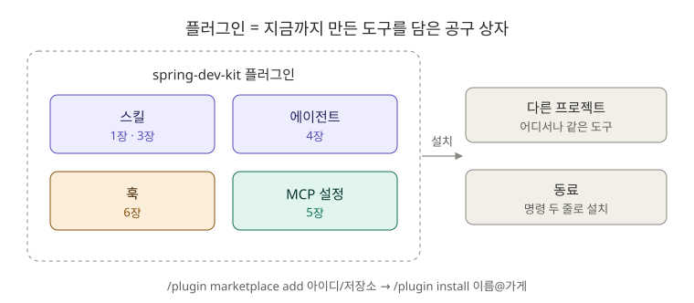

# 7장. 플러그인: 내 도구를 한 묶음으로 (선택)

**⏱ 1시간** · **난이도 ⭐⭐⭐⭐** · **실습 비중 70%**

> 📌 **선택 장이에요.** 지금까지 만든 스킬, 에이전트, 훅을 **다른 프로젝트나 동료에게 나눠 줄 때** 필요한 기능이에요. 취업 준비 중이라면 [졸업 프로젝트](../graduation/README.md)를 먼저 해도 괜찮아요.

## 🎯 이 장을 마치면

- 플러그인과 마켓플레이스가 무엇인지 설명할 수 있어요.
- 1~6장에서 만든 도구를 **`spring-dev-kit` 플러그인**으로 묶어서, 어떤 프로젝트에서든 한 번에 설치할 수 있어요.
- GitHub에 올려서 **동료가 명령 두 줄로 설치**하게 할 수 있어요.

---

## 🖼️ STEP 1. 그림으로 이해하기



> 🧩 **비유:** 지금까지는 공구를 하나씩 들고 다녔어요(프로젝트마다 `.claude/` 폴더에 복사). 플러그인은 **공구 상자**예요. 상자째 들고 가면 어느 현장에서든 바로 꺼내 쓸 수 있어요. **마켓플레이스**는 공구 상자를 모아 둔 **가게**예요.

---

## 📖 STEP 2. 핵심 개념

### ① 플러그인 폴더 구조

```text
spring-dev-kit/
├── .claude-plugin/
│   ├── plugin.json          ← 이름, 설명, 버전 (필수)
│   └── marketplace.json     ← 가게 목록 (배포할 때)
├── skills/                  ← 스킬 폴더들 (1·3장)
├── agents/                  ← 에이전트 파일들 (4장)
├── hooks/hooks.json         ← 훅 설정 (6장)
├── scripts/                 ← 훅 스크립트
└── README.md                ← 설명서
```

지금까지 만든 것과 **폴더 이름이 같아요.** `.claude/` 대신 플러그인 폴더에 넣는 것만 달라요.

### ② 프로젝트 설정과 다른 점

| | `.claude/` 폴더 (지금까지) | 플러그인 |
|---|---|---|
| 적용 범위 | 그 프로젝트만 | 설치한 곳 어디서나 |
| 명령 이름 | `/explain` | `/spring-dev-kit:explain` (이름이 겹치지 않으면 `/explain`도 돼요) |
| 훅 스크립트 경로 | `$CLAUDE_PROJECT_DIR/...` | **`${CLAUDE_PLUGIN_ROOT}/...`** |
| 공유 방법 | 파일 복사 | `/plugin install` |

### ③ 자주 쓰는 명령

| 명령 | 하는 일 |
|---|---|
| `/plugin` | 플러그인 관리 화면 (찾기, 설치, 끄기) |
| `claude --plugin-dir 경로` | 설치하지 않고 **이번 세션에만** 불러오기 (개발·테스트용) |
| `claude plugin validate 경로` | 플러그인 구조가 올바른지 검사 |
| `claude plugin init 이름` | 새 플러그인 뼈대 만들기 |
| `/plugin marketplace add 아이디/저장소` | GitHub 저장소를 가게로 등록 |
| `/plugin install 이름@가게이름` | 가게에서 설치 |
| `/reload-plugins` | 고친 플러그인 다시 불러오기 |

> ⚠️ 플러그인에는 **훅(내 컴퓨터에서 실행되는 명령)** 과 **MCP 서버**가 들어 있을 수 있어요. 믿을 수 있는 곳의 플러그인만 설치하고, 설치 전에 내용을 확인하세요.

---

## 🛠️ STEP 3. 실습 미션

### 🟢 미션 7-1. 공식 마켓플레이스 둘러보기 (10분)

```text
/plugin
```

Anthropic 공식 마켓플레이스(`claude-plugins-official`)가 기본으로 등록되어 있어요. 목록을 둘러보고, 백엔드 개발에 쓸 만한 플러그인이 있는지 찾아보세요. **설치는 설명을 다 읽은 뒤에** 하세요.

✅ **성공 기준:** 플러그인 하나를 골라 "무엇이 들어 있고(스킬, 에이전트, 훅, MCP), 왜 쓸 만한지" 말할 수 있어요.

### 🔵 미션 7-2. spring-dev-kit 조립하기 (20분)

플러그인은 **프로젝트 밖**에 따로 만들어요.

```bash
mkdir -p ~/spring-dev-kit/skills ~/spring-dev-kit/agents ~/spring-dev-kit/scripts
cd ~/spring-dev-kit
cp -r ~/claude-howto/ko/07-plugins/template/. .
cp -r ~/board-api/.claude/skills/explain ~/board-api/.claude/skills/find-bug skills/
cp -r ~/board-api/.claude/skills/spring-test-writer ~/board-api/.claude/skills/pr-description skills/
cp ~/board-api/.claude/agents/*.md agents/
cp ~/board-api/.claude/hooks/block-dangerous.sh scripts/
```

`.claude-plugin/plugin.json`과 `README.md`의 "내 이름"을 바꾸고, 검사합니다.

```bash
claude plugin validate ~/spring-dev-kit
```

✅ **성공 기준:** `Validation passed`가 나와요. 경고(아이콘 없음 등)는 공식 디렉터리에 제출할 때만 필요한 것이라 지금은 괜찮아요.

<details>
<summary>❌ hooks.json에서 에러가 나요</summary>

플러그인 훅의 스크립트 경로는 `$CLAUDE_PROJECT_DIR`가 아니라 **`${CLAUDE_PLUGIN_ROOT}`** 를 써야 해요. 템플릿의 `hooks/hooks.json`을 그대로 쓰면 돼요.

</details>

### 🔵 미션 7-3. 다른 폴더에서 테스트하기 (10분)

플러그인이 **어디서나** 동작하는지 확인하려면 `board-api`가 아닌 곳에서 시험해요.

```bash
mkdir -p ~/plugin-test && cd ~/plugin-test
claude --plugin-dir ~/spring-dev-kit
```

```text
/spring-dev-kit:explain 스프링의 의존성 주입
```

```text
build 폴더를 rm -rf 로 지워 줘.
```

✅ **성공 기준:** 스킬이 실행되고, 훅이 `rm -rf`를 막아요.

### 🔴 도전 7-4. GitHub에 올려서 설치해 보기 (20분)

1. GitHub에 `spring-dev-kit` 저장소를 만들고 올려요 (5장 미션 5-1과 같은 방법).

```bash
cd ~/spring-dev-kit
git init && git add . && git commit -m "feat: spring-dev-kit 0.1.0"
git branch -M main
git remote add origin https://github.com/내아이디/spring-dev-kit.git
git push -u origin main
```

2. Claude Code에서 내 저장소를 가게로 등록하고 설치해요.

```text
/plugin marketplace add 내아이디/spring-dev-kit
```

```text
/plugin install spring-dev-kit@my-dev-tools
```

`my-dev-tools`는 `marketplace.json`의 `name`이에요.

✅ **성공 기준:** `--plugin-dir` 없이도 어느 폴더에서나 `/spring-dev-kit:explain`이 동작해요. 친구에게 위 두 줄을 알려 주면 똑같이 설치할 수 있어요.

> 💡 플러그인을 설치했다면 `board-api/.claude/`에 복사해 둔 같은 스킬과 겹치게 돼요. 둘 중 하나만 쓰도록 정리해 보세요.

---

## ❓ STEP 4. 바로 퀴즈

**Q1.** 플러그인 폴더에서 반드시 있어야 하는 파일은?

<details>
<summary>정답 보기</summary>

**`.claude-plugin/plugin.json`.** 플러그인의 이름, 설명, 버전이 들어 있어요.

</details>

**Q2.** 플러그인을 설치하지 않고 이번 세션에서만 시험해 보는 방법은?

<details>
<summary>정답 보기</summary>

**`claude --plugin-dir 플러그인경로`**

</details>

**Q3.** 플러그인의 `hooks.json`에서 스크립트 경로를 `$CLAUDE_PROJECT_DIR`로 쓰면 왜 안 될까요?

<details>
<summary>정답 보기</summary>

`$CLAUDE_PROJECT_DIR`는 **지금 작업 중인 프로젝트** 폴더예요. 스크립트는 **플러그인 폴더**에 있으니 `${CLAUDE_PLUGIN_ROOT}`를 써야 해요.

</details>

**Q4.** `spring-dev-kit` 플러그인의 `explain` 스킬을 확실하게 부르는 명령은?

<details>
<summary>정답 보기</summary>

**`/spring-dev-kit:explain`.** 플러그인 스킬은 `플러그인이름:스킬이름`으로 불러서 다른 스킬과 이름이 겹치지 않아요.

</details>

**Q5.** 프로젝트 `.claude/`에 두는 것보다 플러그인이 나은 경우는?

<details>
<summary>정답 보기</summary>

**여러 프로젝트에서 같은 도구를 쓰거나, 다른 사람과 나눌 때.** 한 프로젝트에서만 쓰는 팀 규칙은 프로젝트 `.claude/`에 두는 게 더 간단해요.

</details>

---

## 🏢 STEP 5. 현장 레시피

**팀 온보딩용 플러그인:**

```text
우리 팀 프로젝트의 .claude/ 폴더(스킬, 에이전트, 훅)를 분석해서, 여러 저장소에서 공통으로 쓸 수 있는 것만 골라 플러그인으로 묶는 계획을 세워 줘. 프로젝트마다 다른 것은 남겨 두고.
```

**플러그인 버전 올리기:** 기능을 바꾸면 `plugin.json`과 `marketplace.json`의 `version`을 올리고 커밋하세요. 설치한 사람은 `/plugin`에서 업데이트할 수 있어요.

---

## 🎤 STEP 6. 면접 한마디

> "개인 프로젝트에서 쓰던 테스트 작성 스킬, 리뷰 에이전트, 위험 명령 차단 훅을 플러그인으로 묶어 GitHub에 배포했습니다. 새 프로젝트를 시작할 때 명령 한 줄로 같은 개발 환경을 갖출 수 있습니다."

---

## ✅ 마무리 체크

- [ ] 공식 마켓플레이스에서 플러그인 하나를 살펴봤다
- [ ] `spring-dev-kit`을 조립하고 `claude plugin validate`를 통과했다
- [ ] 다른 폴더에서 `--plugin-dir`로 시험했다
- [ ] (도전) GitHub에 올리고 `/plugin install`로 설치했다
- [ ] 퀴즈 5문제를 모두 맞혔다

**다음 → [졸업 프로젝트](../graduation/README.md)**

## 📚 더 알아보기

- 플러그인 구조 전체, 옵션, 마켓플레이스 설정, 보안: [원문 7장](../../07-plugins/README.md)
- 공식 문서: [Plugins](https://code.claude.com/docs/en/plugins)
