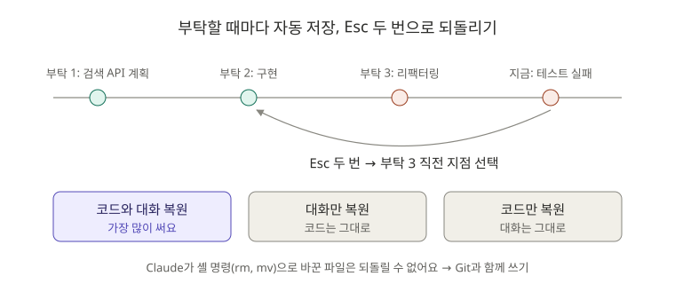
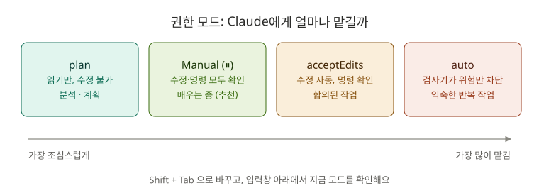

# 8장. 체크포인트와 안전장치: 마음 놓고 일 시키기

**⏱ 1시간** · **난이도 ⭐⭐** · **실습 비중 65%**

> 📌 원문의 8장은 "체크포인트(되돌리기)"만 다뤄요. 이 가이드에서는 입문자가 일찍 알아야 할 **권한 모드, 계획 모드, 변경 검토**까지 함께 묶었어요. 원문에서는 9장에 있는 내용이에요.

## 🎯 이 장을 마치면

- Claude가 코드를 망쳐도 **몇 초 만에 되돌릴** 수 있어요.
- 큰 작업은 **계획부터 보고 승인**한 뒤에 진행시킬 수 있어요.
- Claude가 바꾼 내용을 **diff로 검토**하고 커밋할지 버릴지 판단할 수 있어요.

---

## 🖼️ STEP 1. 그림으로 이해하기



> 🧩 **비유:** 게임의 **자동 저장**과 같아요. 내가 부탁을 보낼 때마다 Claude Code가 자동으로 저장 지점을 만들어요. 보스전에서 지면 저장 지점으로 돌아가듯, 결과가 마음에 안 들면 `Esc`를 두 번 눌러 돌아가면 돼요.



> 🧩 **비유:** 권한 모드는 **신입에게 얼마나 맡길지** 정하는 거예요. 처음에는 하나하나 확인받게 하고(Manual), 익숙해지면 파일 수정은 맡기고(acceptEdits), 큰일은 계획서부터 받아요(plan).

---

## 📖 STEP 2. 핵심 개념

### ① 체크포인트: 자동으로 만들어지는 저장 지점

- 내가 **부탁을 보낼 때마다** 자동으로 만들어져요. 따로 저장할 필요가 없어요.
- `Esc` 두 번 또는 `/rewind`(별칭 `/undo`, `/checkpoint`)로 목록을 열어요.
- 세션을 닫았다가 다시 열어도(`claude --continue`) 남아 있어요. 기본 30일 동안 보관돼요.

**되돌리기 메뉴**

| 선택지 | 무엇이 돌아가나 | 언제 |
|---|---|---|
| 코드와 대화 복원 | 파일 + 대화 모두 | **가장 많이 써요.** 그 시점으로 완전히 돌아가기 |
| 대화만 복원 | 대화만 (파일은 지금 그대로) | 코드는 마음에 드는데 대화가 엉뚱하게 흘러갔을 때 |
| 코드만 복원 | 파일만 (대화는 그대로) | 대화 내용은 살리고 코드만 다시 시도할 때 |
| 여기서부터 요약 / 여기까지 요약 | 아무것도 안 돌아가고 대화를 요약 | 대화가 너무 길어졌을 때 |
| 취소 | 없음 | 그냥 닫기 |

### ② 체크포인트의 한계: Git이 여전히 필요한 이유

| 체크포인트가 **못** 되돌리는 것 | 예시 |
|---|---|
| Claude가 **셸 명령**으로 바꾼 파일 | `rm`, `mv`, `cp`로 지우거나 옮긴 파일 |
| **내가** 편집기에서 직접 고친 내용 | IntelliJ에서 고친 코드 |
| 서브에이전트(4장)가 고친 파일 | |

그래서 **체크포인트는 실험용, Git 커밋은 확정용**으로 함께 써요.

### ③ 권한 모드: 얼마나 맡길까

`Shift + Tab`을 누를 때마다 모드가 바뀌어요. 입력창 아래에 지금 모드가 표시돼요.

| 모드 | Claude가 묻지 않고 하는 일 | 추천 상황 |
|---|---|---|
| **Manual** (⏸, 설정값 `default`) | 파일 읽기만 | **배우는 동안, 처음 보는 코드** |
| **acceptEdits** | 파일 읽기 + 수정 | 무엇을 할지 이미 합의했을 때 |
| **plan** | 파일 읽기만 (수정은 아예 안 함) | 큰 작업 전 계획 세우기, 코드 분석 |
| **auto** | 대부분 (안전 검사기가 위험한 것만 막음) | 익숙해진 뒤 반복 작업 (9장) |

> ⚠️ `bypassPermissions`(`--dangerously-skip-permissions`)는 **모든 확인을 끄는** 모드예요. 버려도 되는 실험 환경이 아니면 쓰지 마세요.

### ④ 계획 모드: 일하기 전에 계획서부터

`Shift + Tab`으로 plan 모드로 바꾸거나 `/plan 할 일`을 입력해요. Claude는 **파일을 읽기만** 하고 계획서를 써요. 계획을 승인해야 실제 수정이 시작돼요.

| 계획 모드가 좋은 일 | 그냥 해도 되는 일 |
|---|---|
| 여러 파일을 고치는 기능 추가 | 오타 수정 |
| 구조 변경, 리팩터링 | 한 파일 안의 작은 버그 |
| 방법이 여러 가지인 문제 | 질문하기 |

### ⑤ 변경 검토: 커밋 전에 꼭

| 방법 | 하는 일 |
|---|---|
| `/diff` | Claude Code 안에서 바뀐 파일과 줄을 보여 줘요 |
| `git diff` | 터미널에서 바뀐 내용 보기 |
| "방금 바꾼 내용을 파일별로 설명해 줘" | 이해가 안 되는 변경을 설명받기 |
| `git restore 파일` | 커밋 전 변경을 버리기 |

---

## 🛠️ STEP 3. 실습 미션

시작하기 전에 지금 상태를 커밋해 두세요. `git status`가 깨끗해야 실습 결과를 비교하기 쉬워요.

```bash
cd ~/board-api
git status
```

### 🟢 미션 8-1. 일부러 망치고 되돌리기 (10분)

```text
PostService의 모든 메서드를 최대한 짧게 한 줄짜리로 바꿔 줘.
```

Manual 모드라면 수정마다 권한을 물어요. 허락해서 끝까지 진행시킨 뒤 `git diff --stat`으로 얼마나 바뀌었는지 보세요. 이제 **되돌립니다.**

1. `Esc`를 두 번 누르세요.
2. 목록에서 **"PostService의 모든 메서드를…" 부탁을 보내기 직전** 지점을 고르세요.
3. **"코드와 대화 복원"** 을 선택하세요.

```bash
git status
```

✅ **성공 기준:** `PostService.java`가 원래대로 돌아와서 `git status`에 나오지 않아요. 입력창에는 아까 보낸 부탁이 다시 들어 있어요.

### 🟢 미션 8-2. 계획 모드로 기능 추가하기 (20분)

`Shift + Tab`을 눌러 **plan 모드**로 바꾸세요. (또는 `/plan`으로 시작해도 돼요.)

```text
게시글 제목으로 검색하는 API를 추가하고 싶어. GET /api/posts/search?keyword=JPA 처럼 쓰고, 제목에 키워드가 포함된 글을 돌려줘. 테스트도 포함해서 계획을 세워 줘.
```

Claude가 쓴 계획서를 읽고 **하나 이상 고쳐 달라고** 해 보세요.

```text
키워드가 비어 있으면 400을 돌려주는 것도 계획에 넣어 줘.
```

계획이 마음에 들면 승인하세요. 승인 화면에 여러 선택지가 나오면 **수정을 하나씩 직접 확인하는 쪽**을 고르세요. 배우는 동안에는 그게 안전해요.

✅ **성공 기준:** 계획대로 구현되고 `./gradlew test`가 통과해요. 아래 명령도 확인하세요.

```bash
curl "http://localhost:8080/api/posts/search?keyword=JPA"
```

### 🔵 미션 8-3. 변경 검토 후 커밋 결정하기 (10분)

```text
/diff
```

바뀐 파일을 하나씩 보면서 스스로 답해 보세요.

- 계획에 없던 파일이 바뀌었나요?
- 이해가 안 되는 줄이 있나요? 있다면 Claude에게 물어보세요.

```text
PostRepository에 추가한 메서드가 어떤 SQL로 바뀌는지 설명해 줘.
```

모두 이해했다면 커밋합니다. 1장에서 만든 `/commit`을 써도 좋아요.

```bash
git add . && git commit -m "feat: 게시글 제목 검색 API 추가"
```

✅ **성공 기준:** 바뀐 모든 줄을 내 말로 설명할 수 있고, 그다음에 커밋했어요.

### 🔴 도전 8-4. 체크포인트가 못 되돌리는 것 체험하기 (10분)

```text
docs/project-overview.md 파일을 셸 명령 mv로 docs/overview.md로 옮겨 줘.
```

옮겨진 것을 확인한 뒤 `Esc` 두 번 → 그 부탁 직전 지점 → **"코드와 대화 복원"** 을 해 보세요. 파일이 돌아왔나요?

<details>
<summary>결과와 해결 방법</summary>

돌아오지 않아요. 셸 명령(`mv`)으로 바꾼 파일은 체크포인트가 추적하지 않기 때문이에요. 이럴 때 Git이 구해 줘요.

```bash
git status
git restore docs/project-overview.md
rm docs/overview.md
```

`docs/project-overview.md`가 아직 커밋되지 않았다면 Git으로도 되살릴 수 없어요. **중요한 파일은 커밋부터** 해야 하는 이유예요.

</details>

---

## ❓ STEP 4. 바로 퀴즈

**Q1.** Claude가 고친 코드가 마음에 안 들어서 **그 부탁을 보내기 전으로 완전히** 돌아가고 싶어요. 어떻게 하나요?

<details>
<summary>정답 보기</summary>

`Esc` 두 번(또는 `/rewind`) → 그 부탁 직전 지점 선택 → **"코드와 대화 복원"**.

</details>

**Q2.** 다음 중 체크포인트로 되돌릴 수 **없는** 것은?

1. Claude가 파일 편집 기능으로 고친 `PostService.java`
2. Claude가 `rm` 명령으로 지운 `data.sql`
3. 직전 대화 내용

<details>
<summary>정답 보기</summary>

**2번.** 셸 명령으로 바꾼 파일은 추적되지 않아요. Git으로 복구해야 해요.

</details>

**Q3.** 처음 보는 회사 코드를 분석만 하고 싶어요. 실수로라도 파일이 바뀌면 안 돼요. 어떤 모드가 알맞나요?

<details>
<summary>정답 보기</summary>

**plan 모드.** 파일을 읽기만 하고 수정은 하지 않아요.

</details>

**Q4.** 다음 중 계획 모드를 쓰기에 **가장 알맞은** 일은?

1. README 오타 수정
2. 회원 탈퇴 기능 추가 (회원, 게시글, 댓글 모두 영향)
3. "이 메서드 뭐 하는 거야?" 질문

<details>
<summary>정답 보기</summary>

**2번.** 여러 파일에 영향을 주는 작업은 계획부터 확인하는 게 안전해요.

</details>

**Q5.** 체크포인트가 있는데도 Git 커밋을 해야 하는 이유 두 가지는?

<details>
<summary>정답 보기</summary>

1. 체크포인트는 셸 명령이나 내가 직접 고친 변경을 추적하지 못해요.
2. 체크포인트는 내 컴퓨터의 세션 기록이라 팀과 공유할 수 없고, 일정 기간이 지나면 지워져요.

</details>

---

## 🏢 STEP 5. 현장 레시피

**큰 작업을 맡길 때의 기본 흐름:**

```text
1. git status로 깨끗한지 확인 (아니면 커밋)
2. plan 모드로 계획 받기 → 계획 수정 → 승인
3. 구현 후 ./gradlew test
4. /diff로 검토 → 이해 안 되는 부분 질문
5. 마음에 들면 커밋, 아니면 Esc 두 번으로 되돌리고 다른 방법 시도
```

**두 가지 방법을 비교하고 싶을 때:**

```text
예외 응답 형식을 A안(status, message)으로 먼저 구현해 줘.
```

테스트까지 확인한 뒤 `Esc` 두 번 → **"코드만 복원"** 을 고르면, A안을 만든 대화는 남아 있는 채로 코드만 처음 상태가 돼요. 그다음 B안을 부탁하면 Claude가 A안과 비교하면서 만들어 줘요.

```text
이번에는 B안(RFC 9457 ProblemDetail)으로 구현해 줘. 끝나면 A안과 장단점을 비교해 줘.
```

---

## 🎤 STEP 6. 면접 한마디

> "AI가 코드를 고칠 때는 큰 작업은 계획 모드로 계획부터 검토하고, 변경 사항은 diff로 전부 확인한 뒤 커밋했습니다. 결과가 마음에 들지 않으면 체크포인트로 되돌려 다른 방법을 비교했습니다."

**예상 꼬리 질문:** "AI가 만든 코드를 어떻게 검증하나요?" → "테스트 실행, diff 검토, 이해 안 되는 줄은 설명받고 이해한 뒤에만 커밋"이라고 구체적으로 답하세요.

---

## ✅ 마무리 체크

- [ ] `Esc` 두 번으로 코드와 대화를 되돌려 봤다
- [ ] plan 모드로 계획을 받고, 수정 요청 후 승인해서 검색 API를 만들었다
- [ ] `/diff`로 변경을 검토하고 모든 줄을 설명할 수 있었다
- [ ] 체크포인트가 셸 명령 변경을 되돌리지 못한다는 것을 확인했다
- [ ] 퀴즈 5문제를 모두 맞혔다

**다음 장 → [10장. CLI ① 기초](../10-cli/README.md#part-1-기초)**

## 📚 더 알아보기

- 되돌리기 옵션과 설정 전체: [원문 8장](../../08-checkpoints/README.md)
- 계획 모드와 권한 모드 전체: [원문 9장](../../09-advanced-features/README.md)
- 공식 문서: [Checkpointing](https://code.claude.com/docs/en/checkpointing)
