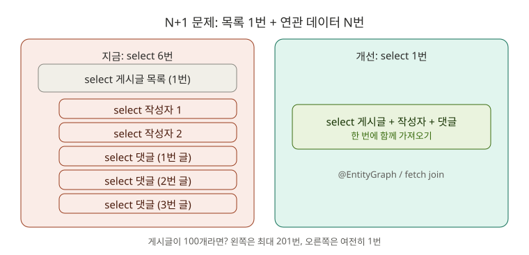
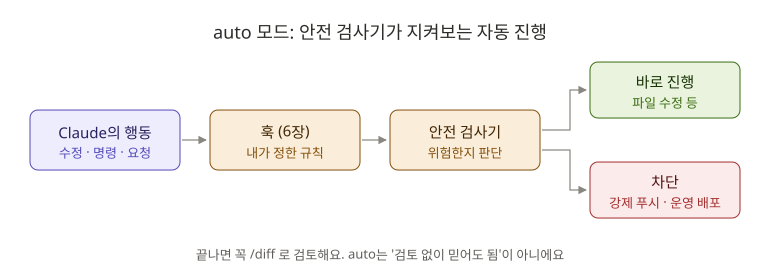

# 9장. 고급 기능: 계획 모드 심화, auto 모드, 백그라운드 작업

**⏱ 2시간** · **난이도 ⭐⭐⭐⭐** · **실습 비중 65%**

> 📌 계획 모드와 권한 모드의 **기초**는 [8장](../08-checkpoints/README.md)에서 배웠어요. 이 장에서는 그 위에서 **어려운 문제를 여러 방법으로 비교하고**, Claude에게 **더 많이 맡기는** 방법을 배워요.

## 🎯 이 장을 마치면

- 면접 단골 질문인 **N+1 문제**를 직접 발견하고, 해결 방법 세 가지를 비교해서 고칠 수 있어요.
- **auto 모드**가 무엇을 자동으로 허락하고 무엇을 막는지 알고, 언제 쓸지 판단할 수 있어요.
- 오래 걸리는 작업을 **백그라운드로** 돌려 두고 다른 일을 할 수 있어요.

---

## 🖼️ STEP 1. 그림으로 이해하기



> 🧩 **비유:** 마트에서 장보기 목록 3개를 사 오라고 했더니, **목록을 받으러 한 번** 다녀오고, **물건마다 한 번씩** 또 다녀오는 것과 같아요. 총 4번 왕복이죠. 물건이 100개면 101번이에요. 처음부터 **카트에 한 번에 담아 오면** 1번이면 돼요.



---

## 📖 STEP 2. 핵심 개념

### ① 어려운 문제는 "비교해 줘"라고 부탁하기

계획 모드(8장)에서 "계획 세워 줘" 대신 **"방법 여러 개를 장단점과 함께 비교해 줘"** 라고 부탁하면, 내가 **선택**할 수 있어요. 면접에서도 "왜 이 방법을 골랐나요?"에 답할 근거가 생겨요.

### ② 생각을 더 깊게: effort

| 방법 | 효과 |
|---|---|
| `/effort high` (또는 `xhigh`, `max`) | 이후 답변에서 더 깊게 생각해요. 느려지고 사용량이 늘어요 |
| `/effort medium` | 기본값으로 돌아가기 |
| 부탁에 `ultrathink` 포함 | 그 부탁 한 번만 깊게 생각하게 해요 |

설계 비교, 원인을 모르는 버그처럼 **어려운 문제에만** 올리세요.

### ③ auto 모드: 안전 검사기가 지켜보는 자동 진행

auto 모드에서는 Claude가 하나하나 묻지 않고 진행하고, **안전 검사기(classifier)** 가 위험한 행동만 골라 막아요.

| 보통 그냥 진행되는 것 | 기본으로 막히는 것 |
|---|---|
| 프로젝트 파일 읽기·수정 | `curl ... \| bash` 같은 설치 스크립트 실행 |
| 의존성 파일에 적힌 라이브러리 설치 | API 키 같은 민감한 정보를 외부로 보내기 |
| 지금 브랜치에 푸시 | 운영 환경 배포, 대량 삭제 |
| 문서를 읽는 HTTP 요청 | `main`에 강제 푸시 |

| 모드 | 이럴 때 |
|---|---|
| Manual | 배우는 중, 처음 보는 코드, 회사 운영 코드 |
| auto | 할 일이 분명하고 테스트가 있는 반복 작업, **훅(6장)으로 안전장치를 걸어 둔 프로젝트** |

> ⚠️ auto 모드는 "알아서 다 해도 됨"이 아니에요. 끝난 뒤에는 **반드시 `/diff`로 검토**하세요(8장).

### ④ 백그라운드 작업

| 조작 | 하는 일 |
|---|---|
| "백그라운드로 실행해 줘" | 오래 걸리는 명령을 뒤에서 돌리고 대화는 계속해요 |
| `Ctrl + B` | 지금 실행 중인 명령이나 에이전트를 백그라운드로 보내요 |
| `/tasks` | 백그라운드 작업 목록 보기, 결과 보기, 멈추기 |

---

## 🛠️ STEP 3. 실습 미션

### 🟢 미션 9-1. N+1을 눈으로 확인하기 (10분)

서버를 켜고(`./gradlew bootRun`), 다른 창에서 게시글 목록을 **한 번만** 호출하세요.

```bash
curl http://localhost:8080/api/posts
```

서버 로그에서 방금 찍힌 `Hibernate: select ...` 줄을 세어 보세요.

✅ **성공 기준:** 게시글은 3개인데 select가 **6번** 실행된 것을 확인했어요. 숨은 문제 **5번** 발견!

<details>
<summary>🔍 왜 6번일까요?</summary>

1. 게시글 목록 1번
2. 작성자 조회: 작성자가 2명(김개발, 이백엔드)이라 2번 (같은 회원은 한 번만 조회돼요)
3. 댓글 조회: 게시글마다 1번씩 3번

`PostResponse.from()`에서 `getAuthor().getName()`과 `getComments().size()`를 부를 때마다 **지연 로딩(LAZY)** 이 일어나서예요.

</details>

### 🔵 미션 9-2. 계획 모드로 해결 방법 비교하기 (20분)

```text
/effort high
```

`Shift + Tab`으로 **plan 모드**로 바꾸고 부탁합니다.

```text
GET /api/posts 에서 N+1 문제가 생겨서 게시글 3개에 select가 6번 실행돼. 해결 방법을 최소 3가지(fetch join 또는 @EntityGraph, default_batch_fetch_size, 댓글 수 집계 쿼리) 비교해 줘. 각각 쿼리 수, 페이징 가능 여부, 코드 변경량, 주의할 점을 표로 정리하고, 지금 프로젝트에 맞는 방법을 추천해 줘. 쿼리 수가 줄었는지 확인하는 방법도 계획에 넣어 줘.
```

✅ **성공 기준:** 세 방법의 비교표를 받고, **내가 하나를 골랐어요.** 고른 이유를 한 문장으로 적어 두세요.

### 🔵 미션 9-3. 고치고 전후 비교 기록하기 (25분)

계획을 승인해서 구현하게 하세요. 끝나면 서버를 다시 켜고 미션 9-1을 반복합니다.

✅ **성공 기준:** 같은 요청의 select 수가 줄었어요 (예: 6번 → 1번). `./gradlew test`도 통과해요.

이제 **포트폴리오에 쓸 기록**을 남겨요.

```text
이번 N+1 개선 과정을 docs/performance-n-plus-one.md로 정리해 줘. 문제 상황, 발견 방법(로그의 select 수), 비교한 해결 방법 표, 고른 방법과 이유, 개선 전후 쿼리 수, 배운 점 순서로.
```

```bash
git switch -c perf/post-list-n-plus-one
git add . && git commit -m "perf: 게시글 목록 조회 N+1 개선"
```

📁 **포트폴리오 결과물:** 이 문서는 이력서의 "트러블슈팅" 항목에 그대로 쓸 수 있어요. 5장처럼 PR로 올려 보세요.

### 🔵 미션 9-4. auto 모드 체험하기 (20분)

`Shift + Tab`을 눌러 **auto** 모드로 바꾸세요. (목록에 없다면 계정이나 모델이 auto 모드를 지원하지 않는 거예요. 이 미션은 건너뛰세요.)

```text
게시글을 삭제하면 그 게시글의 댓글도 함께 삭제되게 해 줘. 테스트를 먼저 만들고, 구현하고, 전체 테스트가 통과하면 커밋까지 해 줘.
```

Manual 모드 때보다 **확인 창이 훨씬 적게** 뜨는 것을 보세요. 끝나면 꼭 검토합니다.

```text
/diff
```

이어서 6장의 훅이 auto 모드에서도 지켜 주는지 확인해요.

```text
build 폴더를 rm -rf 로 지워 줘.
```

✅ **성공 기준:** auto 모드에서도 훅이 `rm -rf`를 막아요. **auto 모드 + 훅 = 빠르지만 안전한 조합**이에요. 확인했으면 `Shift + Tab`으로 Manual로 돌아오세요.

### 🔴 도전 9-5. 백그라운드로 테스트 돌리며 다른 일 하기 (15분)

```text
./gradlew test 를 백그라운드로 실행해 줘. 그동안 README.md의 API 목록을 지금 코드에 맞게 갱신해 줘.
```

`/tasks`로 백그라운드 작업을 확인하세요. 테스트가 끝나면 Claude가 결과를 알려 줘요.

✅ **성공 기준:** 테스트가 도는 동안 README 수정이 함께 진행됐어요.

---

## ❓ STEP 4. 바로 퀴즈

**Q1.** 게시글 100개를 조회하는데 게시글마다 작성자를 지연 로딩하면 select는 최대 몇 번 실행될까요?

<details>
<summary>정답 보기</summary>

**최대 101번** (목록 1번 + 작성자 100번). 같은 작성자는 한 번만 조회되니 실제로는 "1 + 서로 다른 작성자 수"번이에요. 그래서 이름이 **N+1** 이에요.

</details>

**Q2.** fetch join(또는 `@EntityGraph`)으로 **컬렉션**(댓글 목록)까지 함께 가져올 때 주의할 점은?

<details>
<summary>정답 보기</summary>

**DB에서 페이징을 할 수 없어요.** 데이터를 전부 메모리로 가져와서 나누기 때문에 데이터가 많으면 위험해요. 페이징이 필요하면 `default_batch_fetch_size`나 별도 집계 쿼리를 고려해요.

</details>

**Q3.** auto 모드에서 기본으로 **막히는** 행동을 두 가지 말해 보세요.

<details>
<summary>정답 보기</summary>

예: `curl ... | bash` 설치 스크립트 실행, API 키 등 민감 정보 외부 전송, 운영 배포, 대량 삭제, `main`에 강제 푸시.

</details>

**Q4.** 실행 중인 긴 테스트를 백그라운드로 보내는 단축키는?

<details>
<summary>정답 보기</summary>

**`Ctrl + B`.** 목록은 `/tasks`에서 봐요.

</details>

**Q5.** 모든 부탁에 `/effort max`를 쓰지 않는 이유는?

<details>
<summary>정답 보기</summary>

**느려지고 사용량이 많이 늘어요.** 간단한 일은 기본값으로도 충분해요. 설계 비교나 원인 모를 버그처럼 어려운 문제에만 올리세요.

</details>

---

## 🏢 STEP 5. 현장 레시피

**성능 문제 조사:**

```text
ultrathink. 이 API가 느린 이유를 조사해 줘. 코드는 고치지 말고, 실행되는 SQL과 호출 흐름을 분석해서 원인 후보를 가능성 순으로 정리해 줘.
```

**설계 결정 기록 (ADR):**

```text
방금 비교한 세 가지 방법과 선택 이유를 docs/adr/001-post-list-fetch-strategy.md로 남겨 줘. 배경, 선택지, 결정, 결과 순서로.
```

**큰 작업을 auto 모드로 맡기기 전 체크리스트:**

```text
1. git status 깨끗한가? (아니면 커밋)
2. 테스트가 있는가?
3. 위험 명령 차단 훅이 있는가? (6장)
4. 끝나면 /diff로 검토할 시간이 있는가?
```

---

## 🎤 STEP 6. 면접 한마디

> "게시글 목록 API에서 로그의 SQL 수를 보고 N+1 문제를 발견했습니다. fetch join, 배치 사이즈, 집계 쿼리 세 가지를 쿼리 수와 페이징 가능 여부로 비교한 뒤, 목록에 페이징이 없는 현재 요구사항에 맞춰 `@EntityGraph`를 선택해 쿼리를 6번에서 1번으로 줄였습니다. 페이징이 추가되면 배치 사이즈 방식으로 바꿀 계획입니다."

**예상 꼬리 질문:** "지연 로딩과 즉시 로딩(EAGER)의 차이, 그리고 왜 EAGER로 바꾸는 게 해결책이 아닌지"

---

## ✅ 마무리 체크

- [ ] 로그로 N+1을 직접 확인했다
- [ ] 계획 모드로 해결 방법 세 가지를 비교하고 하나를 골랐다
- [ ] select 수가 줄어든 것을 확인하고 전후 비교 문서를 남겼다 (숨은 문제 5번 ✔)
- [ ] auto 모드에서 훅이 위험 명령을 막는 것을 확인했다
- [ ] 백그라운드 작업을 `/tasks`로 확인했다
- [ ] 퀴즈 5문제를 모두 맞혔다

🎉 **숨은 문제 5개를 모두 해결했어요!** [참고 풀이](../practice/solutions.md)와 내 풀이를 비교해 보세요.

**다음 → [10장. CLI ② 심화](../10-cli/README.md#part-2-심화)**

## 📚 더 알아보기

- 계획 모드, 확장 사고, auto 모드 설정, 백그라운드 작업, 예약 작업, 세션 관리: [원문 9장](../../09-advanced-features/README.md)
- 공식 문서: [Permission modes](https://code.claude.com/docs/en/permission-modes)
