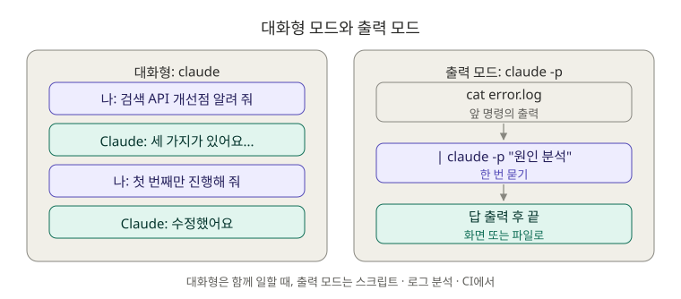
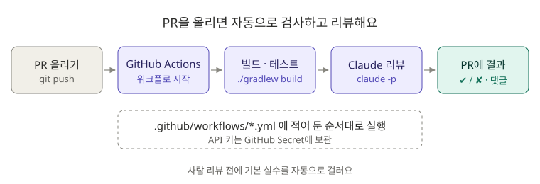

# 10장. CLI: 대화창 밖에서 Claude 쓰기

이 장은 **두 번에 나눠서** 공부해요.

| 파트 | 학습 순서 | 시간 | 내용 |
|---|---|---|---|
| [Part 1 기초](#part-1-기초) | 1단계 마지막 (5번째) | 45분 | `claude -p`, 파이프, 세션 이어 하기 |
| [Part 2 심화](#part-2-심화) | 3단계 (11번째, 5장 이후) | 1시간 | GitHub Actions로 테스트와 PR 리뷰 자동화 |

---

## Part 1 기초

**⏱ 45분** · **난이도 ⭐⭐** · **실습 비중 60%**

### 🎯 이 파트를 마치면

- 대화창을 열지 않고 **명령 한 줄로** Claude에게 일을 시킬 수 있어요.
- 에러 로그, 테스트 결과, Git 기록을 Claude에게 **파이프로 넘겨** 분석할 수 있어요.
- 어제 하던 대화를 **이어서** 할 수 있어요.

### 🖼️ STEP 1. 그림으로 이해하기



> 🧩 **비유:** 대화형 모드는 **선배 자리에 가서 같이 앉아 일하는 것**, 출력 모드(`-p`)는 **메신저로 질문 하나 보내고 답만 받는 것**이에요. 답을 받으면 대화는 끝나고, 결과는 화면에 출력되거나 파일로 저장돼요.

### 📖 STEP 2. 핵심 개념

#### ① 자주 쓰는 명령

| 명령 | 하는 일 |
|---|---|
| `claude` | 대화형 모드 시작 |
| `claude "질문"` | 질문을 보내면서 대화형 모드 시작 |
| `claude -p "질문"` | **출력 모드.** 답만 출력하고 끝 |
| `명령 \| claude -p "질문"` | 앞 명령의 결과를 Claude에게 넘겨서 질문 |
| `claude -c` (`--continue`) | 이 폴더에서 **가장 최근 대화** 이어 하기 |
| `claude -r` (`--resume`) | 지난 대화 목록에서 골라 이어 하기 |
| `claude -n "이름"` | 대화에 이름 붙여서 시작 (나중에 `claude -r 이름`으로 찾기) |
| `claude update` | Claude Code 최신 버전으로 업데이트 |

#### ② 출력 모드에서 자주 쓰는 옵션

| 옵션 | 뜻 | 예시 |
|---|---|---|
| `--output-format json` | 답을 JSON으로 받기 (다른 프로그램에서 쓰기 좋음) | `claude -p --output-format json "..."` |
| `--max-turns 숫자` | Claude가 일하는 횟수 제한 (무한히 돌지 않게) | `claude -p --max-turns 3 "..."` |
| `--model 이름` | 모델 지정 | `claude -p --model haiku "..."` |
| `--permission-mode plan` | 읽기만 하도록 제한 | `claude -p --permission-mode plan "..."` |

#### ③ 파이프 `|` 가 핵심

`A | B`는 "A의 출력을 B의 입력으로 넘긴다"는 뜻이에요. 그래서 로그를 복사해서 붙여넣지 않아도 돼요.

```bash
cat error.log | claude -p "이 로그에서 에러 원인을 알려 줘"
```

### 🛠️ STEP 3. 실습 미션

#### 🟢 미션 10-1. 한 줄로 질문하기 (5분)

```bash
cd ~/board-api
claude -p "이 프로젝트의 API 목록을 한 줄씩 알려 줘"
```

✅ **성공 기준:** 대화창이 열리지 않고 답만 출력된 뒤 터미널로 돌아와요.

#### 🟢 미션 10-2. 에러 로그 분석하기 (15분)

실무에서 가장 많이 쓰는 방법이에요. 이 저장소에 **실제 Spring 에러 로그처럼 만든 샘플**이 있어요. 에러가 두 개 들어 있어요.

```bash
cat ~/claude-howto/ko/10-cli/samples/error.log | claude -p "이 Spring Boot 로그에 있는 에러를 각각 찾아서, 신입 개발자가 이해할 수 있게 원인과 해결 방법을 설명해 줘"
```

1장에서 만든 `/analyze-error` 스킬과 비교해 보세요.

✅ **성공 기준:** 두 에러를 내 말로 설명할 수 있어요.

<details>
<summary>🔍 정답 확인</summary>

1. **`LazyInitializationException`**: 트랜잭션(세션)이 끝난 뒤에 지연 로딩 객체(`Member`)의 값을 읽으려고 해서 났어요. 트랜잭션 안에서 DTO로 바꾸거나, fetch join으로 함께 가져와야 해요.
2. **`DataIntegrityViolationException`**: 이미 있는 이메일(`kim@example.com`)로 회원가입해서 UNIQUE 제약에 걸렸어요. 저장 전에 중복을 검사하고 409 같은 알맞은 응답을 줘야 해요.

둘 다 면접에서 자주 나오는 JPA 예외예요.

</details>

#### 🔵 미션 10-3. 테스트 결과와 Git 기록 요약하기 (10분)

```bash
./gradlew test 2>&1 | tail -40 | claude -p "테스트 결과를 요약해 줘. 실패한 테스트가 있으면 원인 후보도 알려 줘"
```

```bash
git log --oneline -20 | claude -p "이 커밋 기록으로 오늘 한 일을 업무 일지 형식으로 정리해 줘"
```

> 💡 `2>&1`은 에러 출력도 함께 넘기라는 뜻이에요. Gradle은 에러를 따로 출력하기 때문에 이게 없으면 실패 내용이 빠질 수 있어요.

✅ **성공 기준:** 업무 일지가 나와요. 이걸 매일 하면 **취업 준비 일지**가 됩니다.

#### 🔵 미션 10-4. 대화 이어 하기 (10분)

```bash
claude -n "검색 API 개선"
```

```text
8장에서 만든 검색 API를 살펴보고, 개선할 점 3가지만 알려 줘. 고치지는 마.
```

`/exit`로 끈 다음, 이어서 시작합니다.

```bash
claude -c
```

```text
아까 말한 개선점 중 첫 번째만 진행해 줘.
```

✅ **성공 기준:** Claude가 아까 대화를 기억하고 이어서 일해요. `claude -r`로 대화 목록도 열어 보세요.

#### 🔴 도전 10-5. 결과를 파일로 저장하기 (5분)

```bash
claude -p "이 프로젝트의 API 명세를 마크다운 표로 만들어 줘" > docs/api-cli.md
```

1장에서 `/api-docs`로 만든 `docs/api.md`와 비교해 보세요. 반복해서 쓸 일이면 **스킬**로, 스크립트나 CI에서 쓸 일이면 **`-p`** 로 쓰는 게 좋아요.

### ❓ STEP 4. 바로 퀴즈

**Q1.** `claude -p "질문"`과 `claude "질문"`의 차이는?

<details>
<summary>정답 보기</summary>

`-p`는 답만 출력하고 **끝나요.** `-p`가 없으면 질문을 보낸 뒤 **대화형 모드가 계속** 열려 있어요.

</details>

**Q2.** 어제 이 폴더에서 하던 대화를 바로 이어 하려면?

<details>
<summary>정답 보기</summary>

`claude -c` (`--continue`). 여러 대화 중에서 고르려면 `claude -r`.

</details>

**Q3.** `./gradlew test | claude -p "실패 원인"`을 실행했는데 실패 내용이 전달되지 않는 것 같아요. 무엇을 추가해야 할까요?

<details>
<summary>정답 보기</summary>

**`2>&1`.** 에러 출력(stderr)도 함께 파이프로 넘겨요: `./gradlew test 2>&1 | claude -p "..."`

</details>

**Q4.** 출력 모드를 스크립트에서 쓸 때 Claude가 끝없이 일하지 않게 막는 옵션은?

<details>
<summary>정답 보기</summary>

**`--max-turns`.** 예: `--max-turns 3`

</details>

**Q5.** 다른 프로그램이 Claude의 답을 읽어서 처리하게 하려면 어떤 옵션이 좋을까요?

<details>
<summary>정답 보기</summary>

**`--output-format json`.** 답이 JSON으로 나와서 프로그램이 읽기 쉬워요.

</details>

### 🏢 STEP 5. 현장 레시피

```bash
# 운영 로그에서 최근 에러만 분석
tail -500 app.log | grep -A 20 ERROR | claude -p "에러를 종류별로 묶고, 가장 시급한 것부터 원인과 조치를 알려 줘"

# 퇴근 전 업무 일지
git log --since="9 hours ago" --oneline | claude -p "오늘 한 일을 3줄로 요약해 줘"

# 커밋 전 셀프 리뷰
git diff | claude -p "이 변경에서 버그나 빠진 예외 처리가 있으면 알려 줘"
```

> ⚠️ 운영 로그에는 개인정보나 비밀번호가 섞여 있을 수 있어요. 회사 규칙을 확인하고, 민감한 값은 지운 뒤에 넘기세요.

### 🎤 STEP 6. 면접 한마디

> "에러 로그나 테스트 결과를 파이프로 Claude에게 넘겨서 원인 분석 시간을 줄였고, 커밋 전에 `git diff`를 넘겨 셀프 리뷰를 하는 습관을 들였습니다."

### ✅ 마무리 체크

- [ ] `claude -p`로 질문하고 답만 받아 봤다
- [ ] 샘플 에러 로그 두 개의 원인을 설명할 수 있다
- [ ] `2>&1`이 왜 필요한지 안다
- [ ] `claude -c`로 대화를 이어 했다
- [ ] 퀴즈 5문제를 모두 맞혔다

🎉 **1단계 완료!** 이제 Claude와 안전하게 일하는 기본기를 갖췄어요.

**다음 → [3장. 스킬](../03-skills/README.md)** (2단계 시작)

---

## Part 2 심화

**⏱ 1시간** · **난이도 ⭐⭐⭐** · **실습 비중 70%**

> 📌 **먼저 [5장 MCP](../05-mcp/README.md)를 끝내고 오세요.** `board-api`가 GitHub 저장소에 올라가 있어야 해요.

### 🎯 이 파트를 마치면

- PR을 올리면 **테스트가 자동으로 돌아가는** CI를 만들 수 있어요.
- PR을 올리면 **Claude가 자동으로 코드 리뷰 댓글**을 남기게 할 수 있어요.

### 🖼️ STEP 1. 그림으로 이해하기



> 🧩 **비유:** CI는 **공장의 품질 검사 라인**이에요. 내가 코드를 올리면(PR) 검사 라인이 자동으로 돌면서 빌드가 되는지, 테스트가 통과하는지, 리뷰어가 보기에 문제가 없는지 확인해요. 사람이 매번 확인하지 않아도 돼요.

### 📖 STEP 2. 핵심 개념

| 개념 | 설명 |
|---|---|
| **CI** (지속적 통합) | 코드를 올릴 때마다 자동으로 빌드·테스트하는 것 |
| **GitHub Actions** | GitHub이 제공하는 CI 도구. `.github/workflows/*.yml` 파일로 설정해요 |
| **워크플로** | "언제(on) 무엇을(jobs) 할지" 적은 YAML 파일 |
| **Secret** | API 키처럼 코드에 쓰면 안 되는 값을 GitHub에 따로 저장한 것 |
| **`claude -p`** | Part 1에서 배운 출력 모드. CI에서는 대화할 사람이 없으니 이걸 써요 |

> 💰 **비용 주의:** CI에서 Claude를 쓰려면 [Claude Console](https://console.anthropic.com)에서 발급한 **API 키**가 필요하고, 쓰는 만큼 **따로 요금**이 나가요. Pro/Max 구독과는 별도예요. 연습할 때는 PR을 너무 자주 올리지 마세요.

### 🛠️ STEP 3. 실습 미션

#### 🟢 미션 10-6. 테스트 자동 실행 CI 만들기 (15분)

이 미션은 **API 키 없이** 무료로 할 수 있어요.

```bash
cd ~/board-api
mkdir -p .github/workflows
cp ~/claude-howto/ko/10-cli/templates/ci.yml .github/workflows/ci.yml
```

파일을 열어 한 줄씩 무슨 뜻인지 Claude에게 물어보세요.

```text
@.github/workflows/ci.yml 이 파일을 한 줄씩 신입 눈높이로 설명해 줘.
```

브랜치를 만들어 PR로 올립니다.

```bash
git switch -c ci/add-test-workflow
git add .github && git commit -m "ci: PR마다 빌드와 테스트 실행"
git push -u origin ci/add-test-workflow
```

GitHub에서 PR을 만들면 **Checks** 탭에서 CI가 도는 것을 볼 수 있어요.

✅ **성공 기준:** PR에 초록색 ✔ 표시가 떠요. 실패하면 로그를 복사해서 Claude에게 물어보세요.

#### 🔵 미션 10-7. 일부러 CI 깨뜨려 보기 (10분)

```text
3장에서 만든 API 테스트 중 하나를 일부러 실패하게 바꿔 줘. 기대하는 상태 코드를 틀린 값으로.
```

커밋하고 푸시한 뒤 PR에 빨간 ✘가 뜨는 것을 확인하세요. 그다음 되돌리고 다시 푸시합니다.

✅ **성공 기준:** "CI가 실패하면 머지하면 안 된다"를 눈으로 확인했어요. 3장에서 테스트를 만들지 않았다면 이 미션은 건너뛰세요.

#### 🔴 도전 10-8. Claude 자동 리뷰 붙이기 (20분)

1. GitHub 저장소 → **Settings → Secrets and variables → Actions → New repository secret**
2. 이름 `ANTHROPIC_API_KEY`, 값에 API 키를 넣고 저장해요.
3. 템플릿을 복사합니다.

```bash
cp ~/claude-howto/ko/10-cli/templates/claude-review.yml .github/workflows/claude-review.yml
```

리뷰 요청문(프롬프트)은 `claude -p` 뒤의 글이에요. **우리 팀 기준**에 맞게 고쳐 보세요. 예를 들어 2장의 `CLAUDE.md` 규칙을 넣으면 좋아요.

PR을 하나 올리면 몇 분 뒤 Claude의 리뷰 댓글이 달려요.

✅ **성공 기준:** PR에 한국어 리뷰 댓글이 달려요.

> 💡 **더 쉬운 방법:** Claude Code에서 `/install-github-app`을 실행하면 GitHub 앱 설치와 워크플로 설정을 안내해 줘요. PR 댓글에서 `@claude`를 불러 일을 시키는 방식이에요. 자세한 내용은 [공식 문서](https://code.claude.com/docs/en/github-actions)를 보세요.

### ❓ STEP 4. 바로 퀴즈

**Q1.** GitHub Actions 워크플로 파일은 어디에 두나요?

<details>
<summary>정답 보기</summary>

**`.github/workflows/`** 폴더 안에 `.yml` 파일로 둬요.

</details>

**Q2.** API 키를 워크플로 파일에 직접 쓰면 안 되는 이유와 대신 쓰는 방법은?

<details>
<summary>정답 보기</summary>

저장소에 올라가면 **누구나 키를 볼 수 있어요.** GitHub **Secret**에 저장하고 `${{ secrets.ANTHROPIC_API_KEY }}`로 불러 써요.

</details>

**Q3.** CI에서 `claude` 대신 `claude -p`를 쓰는 이유는?

<details>
<summary>정답 보기</summary>

CI에는 **대화할 사람이 없어요.** 출력 모드는 답을 출력하고 바로 끝나서 자동화에 맞아요.

</details>

**Q4.** Windows에서 커밋한 프로젝트의 CI에서 `./gradlew: Permission denied`가 났어요. 이유는?

<details>
<summary>정답 보기</summary>

Windows에서는 파일의 **실행 권한**이 Git에 기록되지 않을 수 있어요. 템플릿처럼 `chmod +x gradlew`를 먼저 실행하거나, `git update-index --chmod=+x gradlew`로 권한을 기록해 두세요.

</details>

**Q5.** Claude 자동 리뷰가 있으면 사람 리뷰는 필요 없을까요?

<details>
<summary>정답 보기</summary>

**아니요.** AI 리뷰는 놓치는 것도 있고, 요구사항이 맞는지는 사람이 판단해야 해요. AI 리뷰는 사람 리뷰 **전에** 기본적인 실수를 걸러 주는 역할이에요.

</details>

### 🏢 STEP 5. 현장 레시피

**CI가 실패했을 때:**

```text
GitHub Actions에서 빌드가 실패했어. 아래 로그를 보고 원인과 고칠 파일을 알려 줘.
(실패한 단계의 로그를 붙여넣기)
```

**팀 저장소에 워크플로를 추가하기 전에:**

```text
@.github/workflows/claude-review.yml 이 워크플로가 우리 저장소에서 문제를 일으킬 만한 부분(권한, 비용, 비밀값 노출)을 검토해 줘.
```

### 🎤 STEP 6. 면접 한마디

> "개인 프로젝트에도 GitHub Actions로 PR마다 빌드와 테스트가 돌게 했고, Claude로 1차 코드 리뷰를 자동화해서 리뷰 전에 기본적인 실수를 걸렀습니다. API 키는 Secret으로 관리했습니다."

### ✅ 마무리 체크

- [ ] PR마다 테스트가 도는 CI를 만들었다
- [ ] CI가 실패하는 것과 고쳐서 통과하는 것을 확인했다
- [ ] (선택) Claude 자동 리뷰 댓글을 받아 봤다
- [ ] 퀴즈 5문제를 모두 맞혔다

**다음 → [7장. 플러그인](../07-plugins/README.md)** (선택) 또는 **[졸업 프로젝트](../graduation/README.md)**

## 📚 더 알아보기

- CLI 명령과 옵션 전체, CI 예시, 환경 변수: [원문 10장](../../10-cli/README.md)
- 출력 모드와 세션 관리: [원문 9장](../../09-advanced-features/README.md)
- 공식 문서: [CLI reference](https://code.claude.com/docs/en/cli-reference)
