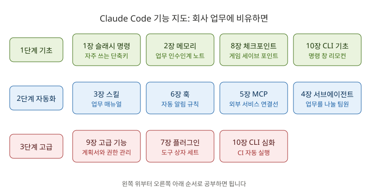

# 📚 백엔드 취준생을 위한 Claude Code 학습 가이드

> Spring Boot로 백엔드 개발자를 준비하는 **입문자**를 위한 한국어 학습 자료입니다.
> 원문 [Claude How To](../README.md)를 바탕으로, **그림으로 이해하고 → 퀴즈로 확인하고 → 실습으로 손에 익히는** 순서로 다시 구성했습니다.

---

## 🎯 이 가이드를 끝내면

- 처음 보는 Spring Boot 프로젝트를 Claude Code로 **빠르게 파악**할 수 있어요.
- 버그 찾기, 테스트 작성, 코드 리뷰, 커밋 메시지 작성을 **Claude에게 맡기고 결과를 검토**할 수 있어요.
- 반복하는 일을 **나만의 명령, 스킬, 자동 검사**로 만들어 내 방식대로 쓸 수 있어요.
- 포트폴리오에 남길 **결과물**과 면접에서 말할 **경험**이 생겨요.

---

## 🧭 내 수준 확인하기

해당하는 것에 체크해 보세요.

- [ ] 터미널(검은 명령 창)에서 `cd`, `ls` 같은 명령을 써 봤다
- [ ] Spring Boot 프로젝트를 실행해 본 적이 있다
- [ ] `claude`를 실행해서 대화해 봤다
- [ ] `/help` 같은 슬래시 명령을 3개 이상 써 봤다
- [ ] CLAUDE.md 파일을 만들어 봤다

| 체크 수 | 시작 위치 |
|---|---|
| 0~2개 | **[0장 시작 전 준비](00-getting-started/README.md)** 부터 |
| 3~4개 | 0장은 "실습 프로젝트 준비"만 하고 **[1장](01-slash-commands/README.md)** 부터 |
| 5개 | 1·2장은 퀴즈만 풀어 보고, 틀린 장부터 |

---

## 🗺️ 학습 순서

폴더 번호(원문의 장 번호)와 학습 순서가 다릅니다. **아래 표의 순서대로** 공부하세요.

| 순서 | 장 | 배우는 것 | `board-api`에서 하는 실무 | 📁 남는 결과물 | 시간 |
|---|---|---|---|---|---|
| **🟢 1단계: Claude와 안전하게 일하기** | | | | | **약 5시간** |
| 1 | [0장 시작 전 준비](00-getting-started/README.md) | 설치, 첫 대화, 좋은 부탁 쓰는 법 | 처음 받은 프로젝트 파악하기 | 프로젝트 구조 문서 | 1시간 |
| 2 | [1장 슬래시 명령](01-slash-commands/README.md) | `/` 명령, 첫 스킬 | 500 에러를 404로 고치기 | 나만의 명령 5개 | 1시간 |
| 3 | [2장 메모리](02-memory/README.md) | CLAUDE.md, 규칙 파일 | 팀 규칙·실행 방법 적어 두기 | `CLAUDE.md` | 45분 |
| 4 | [8장 체크포인트와 안전장치](08-checkpoints/README.md) | 되돌리기, 계획 모드, 권한 모드, 변경 검토 | 리팩터링하다 망치면 되돌리기 | 안전하게 일 시키는 습관 | 1시간 |
| 5 | [10장 CLI ① 기초](10-cli/README.md#part-1-기초) | `claude -p`, 파이프, 세션 이어 하기 | 에러 로그 분석 | 로그 분석 명령 | 45분 |
| **🔵 2단계: 반복 작업 자동화** | | | | | **약 5시간** |
| 6 | [3장 스킬](03-skills/README.md) | 업무 매뉴얼 만들기 | 테스트 먼저 쓰고 입력값 검증 고치기 | 테스트 코드 + 스킬 | 1.5시간 |
| 7 | [6장 훅](06-hooks/README.md) | "~할 때마다 자동으로" | 수정할 때마다 자동 컴파일, 위험 명령 막기 | 자동 품질 검사 | 1시간 |
| 8 | [4장 서브에이전트](04-subagents/README.md) | 일을 나눠 맡기기 | 보안 리뷰로 비밀번호 암호화 | 리뷰 담당 에이전트 | 1.5시간 |
| 9 | [5장 MCP](05-mcp/README.md) | 외부 서비스 연결 | GitHub 이슈 → 브랜치 → PR | MCP 설정, 첫 PR | 1시간 |
| **🔴 3단계: 실무 수준으로** | | | | | **약 5시간** |
| 10 | [9장 고급 기능](09-advanced-features/README.md) | 계획 모드 심화, auto 모드, 백그라운드 작업 | N+1 문제 개선 | 개선 전후 비교 기록 | 2시간 |
| 11 | [10장 CLI ② 심화](10-cli/README.md#part-2-심화) | CI 자동화 | PR 자동 리뷰 | GitHub Actions 워크플로 | 1시간 |
| 12 | [7장 플러그인](07-plugins/README.md) *(선택)* | 기능 묶음 | 내 도구를 플러그인으로 | 개발 플러그인 | 1시간 |
| 🎓 | [졸업 프로젝트](graduation/README.md) | 전부 활용 | 내 프로젝트 처음부터 만들기 | 포트폴리오 저장소 | 자유 |

> 💡 **1단계만 끝내도 실무에서 바로 쓸 수 있어요.** 2·3단계는 하루 1시간씩, 필요한 장부터 골라 봐도 됩니다.

### 왜 이 순서인가요?

| 결정 | 이유 |
|---|---|
| **안전장치(8장)를 1단계에** | Claude는 0장부터 내 파일을 고쳐요. 되돌리는 법과 "계획 먼저 보여 줘"를 일찍 알아야 마음 놓고 실험할 수 있어요 |
| **서브에이전트(4장)를 MCP(5장)보다 먼저** | 서브에이전트는 준비물이 없지만, MCP는 GitHub 계정과 인증 설정이 필요해서 막히기 쉬워요. 쉬운 것부터 해요 |
| **MCP → CI(10장 ②) 순서** | GitHub에 PR을 올려 보고 나서 PR 자동 리뷰를 붙이면 흐름이 자연스럽게 이어져요 |
| **플러그인(7장)은 선택** | 내 도구를 남에게 나눠 줄 때 필요한 기능이라, 취업 준비 단계에서는 우선순위가 낮아요 |

---

## 📖 모든 장은 같은 순서로 진행돼요

| 단계 | 내용 | 비중 |
|---|---|---|
| 🖼️ **STEP 1. 그림으로 이해하기** | 개념 그림과 비유로 큰 그림 잡기 | 10% |
| 📖 **STEP 2. 핵심 개념** | 꼭 필요한 것만 3~4개 | 15% |
| 🛠️ **STEP 3. 실습 미션** | `board-api`에서 실제로 해 보기 | **50%** |
| ❓ **STEP 4. 바로 퀴즈** | 5문제, 정답은 클릭해서 확인 | 10% |
| 🏢 **STEP 5. 현장 레시피** | 실무에서 바로 복사해 쓰는 예시 | 10% |
| 🎤 **STEP 6. 면접 한마디** | 배운 것을 내 경험으로 말하는 법 | 5% |

**실습 미션의 난이도 표시**

- 🟢 **기본**: 그대로 따라 하면 됩니다.
- 🔵 **응용**: 조금 바꿔서 해 봅니다.
- 🔴 **도전**: 힌트만 보고 스스로 해 봅니다.

---

## 🧪 실습 프로젝트: `board-api`

회원, 게시글, 댓글 기능이 있는 작은 **Spring Boot 4 + JPA + H2** 게시판 API입니다. 신입 개발자가 처음 받는 코드처럼 **고쳐야 할 문제가 일부러 숨어 있어요.** 장을 진행하면서 하나씩 찾아 고칩니다.

👉 **[board-api 실습 프로젝트 안내](practice/board-api/README.md)**

---

## 💡 공부 요령

1. **읽기보다 실행.** 실습 미션을 건너뛰면 남는 것이 없어요.
2. **Claude가 고친 코드는 반드시 내 말로 설명해 보기.** 설명하지 못하는 코드는 면접에서 오히려 약점이 됩니다.
3. **막히면 Claude에게 질문.** "이 에러 무슨 뜻이야?", "이 개념을 신입 눈높이로 설명해 줘"라고 물어보세요.
4. **장이 끝나면 퀴즈.** 장마다 있는 "바로 퀴즈" 5문제를 풀고, 이 저장소 폴더에서 `claude`를 켜고 `/ko-quiz 1`처럼 입력하면 채점해 주는 8문제 퀴즈도 풀 수 있어요. 장 번호는 `0`~`9`, `10-1`, `10-2`예요.
5. **장이 끝날 때마다 `git commit`.** 내 학습 기록이 곧 포트폴리오가 됩니다.
6. **모르는 단어는 [용어집](glossary.md)에서.**

---

## 📚 원문과의 관계

이 가이드는 원문을 한 줄씩 옮긴 번역이 아닙니다. 입문자에게 필요한 내용만 골라 쉽게 다시 썼어요. 모든 옵션, 버전별 변경 사항, 기업용 설정은 각 장 끝의 **"더 알아보기"** 에서 원문으로 연결됩니다.

| 원문 | 이 가이드 |
|---|---|
| 기능 설명 중심 레퍼런스 | 그림 → 퀴즈 → 실습 중심 학습서 |
| 모든 옵션과 버전 이력 | 입문자에게 필요한 핵심만 |
| 장마다 따로 노는 예제 | 하나의 실습 프로젝트를 계속 발전시킴 |

*이 가이드는 Claude Code v2.1.302 기준 원문을 바탕으로 작성했습니다.*
