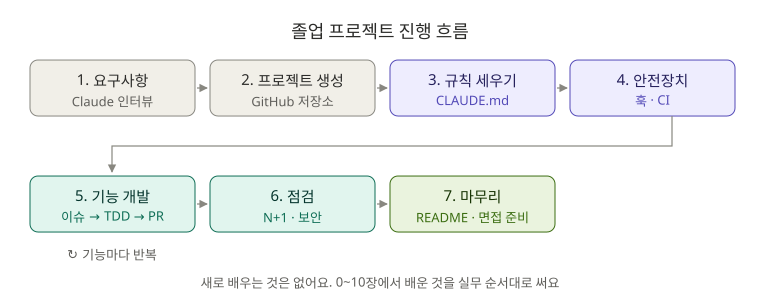

# 🎓 졸업 프로젝트: 내 프로젝트를 처음부터 Claude Code와 만들기

**⏱ 1~2주 (하루 1~2시간)** · **난이도 ⭐⭐⭐⭐** · **실습 비중 100%**

지금까지는 **이미 만들어진** `board-api`를 고쳤어요. 이제 **빈 폴더에서** 내 포트폴리오 프로젝트를 만들어요. 새로 배우는 건 없어요. 0~10장에서 배운 것을 **실무 순서대로** 전부 써 보는 시간이에요.



---

## 1. 주제 고르기

하나를 고르거나, 내가 만들고 싶은 것으로 정하세요. **CRUD + 연관관계 + 인증 또는 동시성** 중 하나가 들어가면 면접에서 이야기할 거리가 생겨요.

| 주제 | 핵심 기능 | 면접에서 이야기할 거리 |
|---|---|---|
| 🛒 쇼핑몰 주문 API | 상품, 장바구니, 주문, 재고 차감 | 재고 동시성(락), 트랜잭션 |
| 📚 도서 대여 API | 도서, 회원, 대여·반납, 연체 | 상태 변경 규칙, 스케줄러 |
| 🗓️ 회의실 예약 API | 회의실, 예약, 시간 겹침 검사 | 중복 예약 방지, 검증 로직 |

---

## 2. 진행 단계와 쓰는 기능

| 단계 | 할 일 | 쓰는 기능 (장) | ✅ 완료 기준 |
|---|---|---|---|
| **1. 요구사항** | Claude에게 인터뷰를 받아 요구사항 문서 만들기 | 계획 모드 (8) | `docs/requirements.md` |
| **2. 프로젝트 생성** | [Spring Initializr](https://start.spring.io)로 프로젝트 만들고 GitHub에 올리기 | MCP (5) | 첫 커밋, 빈 저장소 아님 |
| **3. 규칙 세우기** | `CLAUDE.md`, `.claude/rules/`, 설정, 플러그인 | 메모리 (2), 플러그인 (7) | Claude가 규칙대로 계획을 세움 |
| **4. 안전장치** | 컴파일 훅, 위험 명령 차단, CI | 훅 (6), CLI ② (10) | PR에 CI ✔ |
| **5. 기능 개발 반복** | 기능마다 이슈 → 브랜치 → 계획 → TDD → 리뷰 → PR | 스킬 (3), 서브에이전트 (4), 체크포인트 (8) | 기능마다 PR 1개 이상 |
| **6. 성능·보안 점검** | N+1, 비밀번호, 입력값 검증 점검 | 서브에이전트 (4), 고급 기능 (9) | 점검 결과 문서 |
| **7. 마무리** | README, 트러블슈팅 문서, 면접 준비 | 스킬 (3), CLI ① (10) | 아래 체크리스트 통과 |

---

## 3. 단계별 부탁 예시

### 1단계. 요구사항 인터뷰

`Shift + Tab`으로 plan 모드를 켜고 시작하세요.

```text
나는 Spring Boot로 "도서 대여 API"를 포트폴리오로 만들려고 해. 바로 설계하지 말고, 요구사항을 정리할 수 있게 나에게 질문을 하나씩 해 줘. 질문이 끝나면 기능 목록, API 목록, 엔티티와 관계, 예외 상황을 docs/requirements.md로 정리해 줘.
```

### 3단계. 규칙 세우기

```text
docs/requirements.md를 바탕으로 CLAUDE.md를 만들어 줘. board-api에서 쓰던 규칙(계층 구조, DTO record, orElseThrow, 한글 테스트 이름, 커밋 형식)을 넣고, 이 프로젝트에 필요한 규칙이 더 있으면 제안해 줘.
```

### 5단계. 기능 하나 개발하기 (기능마다 반복)

```text
1. GitHub 이슈 #3을 읽고 feature/rental 브랜치를 만들어 줘.
2. (plan 모드) 구현 계획을 세워 줘. 테스트 목록부터.
3. spring-test-writer 스킬로 테스트 먼저 쓰고 구현해 줘.
4. spring-code-reviewer와 security-reviewer에게 동시에 리뷰시켜 줘.
5. "꼭 고칠 것"을 반영하고 /pr-description 으로 PR을 만들어 줘.
```

### 6단계. 점검

```text
ultrathink. 이 프로젝트 전체에서 N+1 가능성, 트랜잭션 문제, 보안 문제, 빠진 입력값 검증을 찾아서 우선순위 표로 정리해 줘. 고치지는 말고.
```

### 7단계. 포트폴리오 문서

```text
이 프로젝트의 README.md를 포트폴리오용으로 써 줘. 프로젝트 소개, 기술 스택, ERD(Mermaid), API 목록, 실행 방법, 트러블슈팅(링크), 테스트 실행 방법 순서로.
```

```text
git log와 docs/ 폴더를 보고, 이 프로젝트에서 면접관이 물어볼 만한 질문 10개와 내 코드에 근거한 모범 답안을 docs/interview.md로 만들어 줘.
```

> ⚠️ **모범 답안을 외우지 말고, 내 말로 다시 써 보세요.** 면접관은 "그 코드를 왜 그렇게 짰나요?"를 계속 파고들어요. Claude가 쓴 코드 중 **설명할 수 없는 부분이 있다면 그게 다음 공부 주제**예요.

---

## 4. 완성 체크리스트

### 코드

- [ ] 모든 API에 성공·실패 테스트가 있고 `./gradlew test`가 통과한다
- [ ] 없는 데이터는 404, 잘못된 입력은 400을 돌려준다
- [ ] 비밀번호 같은 민감 정보는 해시해서 저장하고, 응답에 나가지 않는다
- [ ] 목록 조회에서 N+1을 확인하고 필요한 곳은 고쳤다

### 협업 흔적

- [ ] 기능마다 이슈 → 브랜치 → PR로 진행했다
- [ ] PR마다 CI가 돌고 통과했다
- [ ] 커밋 메시지가 `타입: 제목` 형식이다

### Claude Code 활용

- [ ] `CLAUDE.md`와 `.claude/rules/`가 있다
- [ ] 직접 만든 스킬이 1개 이상 있다
- [ ] 훅으로 안전장치를 걸었다

### 문서

- [ ] README에 실행 방법, API 목록, ERD가 있다
- [ ] 트러블슈팅 문서가 1개 이상 있다 (예: N+1 개선, 동시성 문제)
- [ ] `docs/interview.md`의 질문에 **내 말로** 답할 수 있다

---

## 5. 스스로 평가하기

| 항목 | ⭐ | ⭐⭐ | ⭐⭐⭐ |
|---|---|---|---|
| **기능** | CRUD 동작 | 연관관계, 예외 처리 | 동시성·성능 문제까지 해결 |
| **테스트** | 일부 API | 모든 API 성공·실패 | 경계 값, 동시성 테스트 |
| **협업 흔적** | 커밋만 있음 | 이슈·PR 흐름 | CI + 리뷰 반영 기록 |
| **AI 활용** | 질문만 함 | 스킬·에이전트로 반복 작업 자동화 | 훅·CI까지 안전하게 자동화 |
| **이해도** | 코드 설명이 막힘 | 대부분 설명 가능 | 선택한 이유와 대안까지 설명 |

**가장 중요한 건 마지막 줄이에요.** AI를 잘 쓰는 개발자는 AI가 만든 결과를 **검증하고 설명할 수 있는** 개발자예요.

---

## 🎉 수고했어요!

여기까지 왔다면 Claude Code로 **처음 보는 코드를 파악하고, 안전하게 고치고, 반복 작업을 자동화하고, 팀의 흐름(이슈·PR·CI)에 맞춰 일하는 법**을 익혔어요.

**이제부터 할 것:**

- 새 기능이 나오면 원문 저장소의 [CHANGELOG](../../CHANGELOG.md)와 `/release-notes`를 확인하세요.
- 같은 부탁을 세 번 하면 스킬로, 같은 실수를 두 번 하면 훅이나 CLAUDE.md 규칙으로 만드세요.
- 한국어 퀴즈(`/ko-quiz`)로 장마다 실력을 다시 점검해 보세요.

**← [학습 가이드 처음으로](../README.md)**
